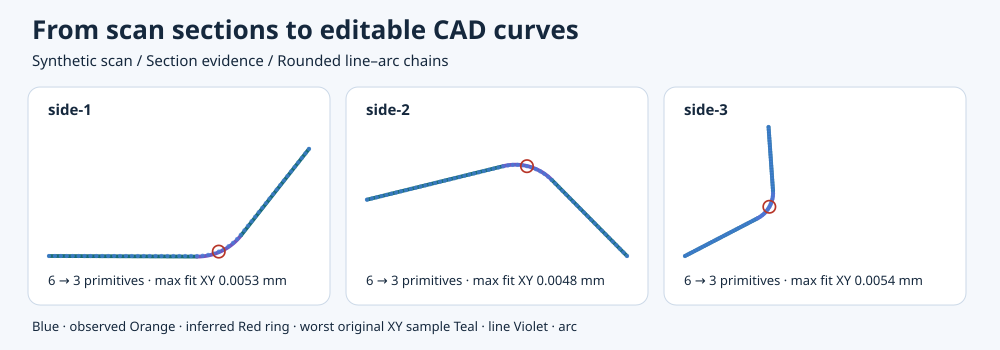

# 從 3D 掃描到可編輯 CAD 草圖

**C# 計算幾何** · **3DEXPERIENCE CATIA C#／VSTA Macro 開發與除錯**

把掃描得到的板金邊緣，轉成工程師能在 CATIA 逐段編輯的直線與圓弧。我的工作包括追查哪些剖切點真的來自目標側壁、控制線弧的擬合誤差，以及用 C# Macro 建立草圖並讀回 CATIA 的結果。公開版用獨立撰寫的程式和合成工件重現這條路徑，也保留早期方案和淘汰原因。



| 你想看什麼 | 從這裡開始 |
| --- | --- |
| **跑一次** | [快速開始](#快速開始) · [輸出怎麼讀](docs/system.md#輸出與來源) |
| **讀幾何與 Macro** | [幾何推導與程式](docs/geometry.md) · [VSTA 編輯、約束與讀回](docs/macro.md) |
| **接手與排錯** | [輸出欄位、驗證及故障定位](docs/handoff.md) |
| **看我怎麼選方案** | [25 個可跑的歷史方法](docs/engineering-decisions.md) · [專案時間線與角色](docs/project-history.md) |

## 兩個技術案例

- **幾何演算**。蓋面來源重複會讓程式把同一支持誤配到兩層，形成凹折。我從剖切邊身分定位錯誤錨點，用單變數對照檢查凹折，再以有限曲線點距和 G1（接點兩側切向一致）驗證減段。公開合成基準每側由 6 段合併為 3 段。 [混蓋診斷](docs/history/mixed-cover.md) · [擬合、減段與取整](docs/geometry.md#相切線弧與減段)
- **3DEX Macro**。在 VSTA 編輯及建置 C# Macro，已從 IDE 的 F5 實跑 `CATMain`。將帶正負掃掠的線弧轉為 Sketcher 實體、端點接合、相切與半徑驅動約束，讓 CATIA 更新後再讀回。草圖身分與輸入指紋核對後才進延伸面。 [Macro 原始碼](macro/MacroWorkflow.cs) · [原生與離線驗證](docs/verification.md)

## 快速開始

這段示範在離線環境執行。先安裝 [.NET 10 SDK](https://dotnet.microsoft.com/download/dotnet/10.0)，在作品集根目錄確認 `dotnet --version` 顯示 `10.x`。重跑時，為輸入和輸出換新的目錄名稱。

```shell
dotnet build src/Cli -c Release
dotnet src/Cli/bin/Release/net10.0/Cli.dll generate normal artifacts/demo-input
dotnet src/Cli/bin/Release/net10.0/Cli.dll run artifacts/demo-input artifacts/demo-output
dotnet src/Cli/bin/Release/net10.0/Cli.dll verify artifacts/demo-input artifacts/demo-output
dotnet src/Cli/bin/Release/net10.0/Cli.dll experiment run mixed-cover
```

正常示範會印出 `Checked 3/3 CAD sides`。先開啟 `artifacts/demo-output/overlay.svg`。藍點是從三角面剖切得到的側壁支持，青綠線及紫色圓弧是取整後的 CAD 輪廓。數字在 `verification.json`，Macro 輸入在 `cad-plan.json`。Windows 可用 `dotnet run --project src/Viewer -- artifacts/demo-output/run.json` 檢視各側。 [驗收報告](docs/verification.md)

## 履歷摘要

- **中文**：開發 C#／WinForms 掃描側線重建與 CAD 交付流程，針對剖切拓撲與蓋壁誤配建立來源追查，以有限線弧距離、G1 相切與取整位移界驗證草圖。
- **中文**：開發與除錯 3DEXPERIENCE CATIA C#／VSTA Macro，建立可編輯的約束草圖、執行原生幾何讀回，並將驗證後的草圖用於延伸面建模。
- **English**: Developed a C# / WinForms scan-to-CAD workflow for section provenance, tangent line–arc reconstruction, and tolerance-checked dimension rounding.
- **English**: Developed and debugged CATIA automation in C# for 3DEXPERIENCE VSTA, including editable sketch constraints, native geometry readback, and surface extrusion.

公開內容使用合成工件與去識別摘要。CLI 已在 Windows 和 Debian Linux 虛擬機建置與重跑。歷史原生建模、公開範例測試與實際製造貼合各有獨立狀態。 [驗證範圍](docs/verification.md) · [作品集審查與修正](docs/review.md)
