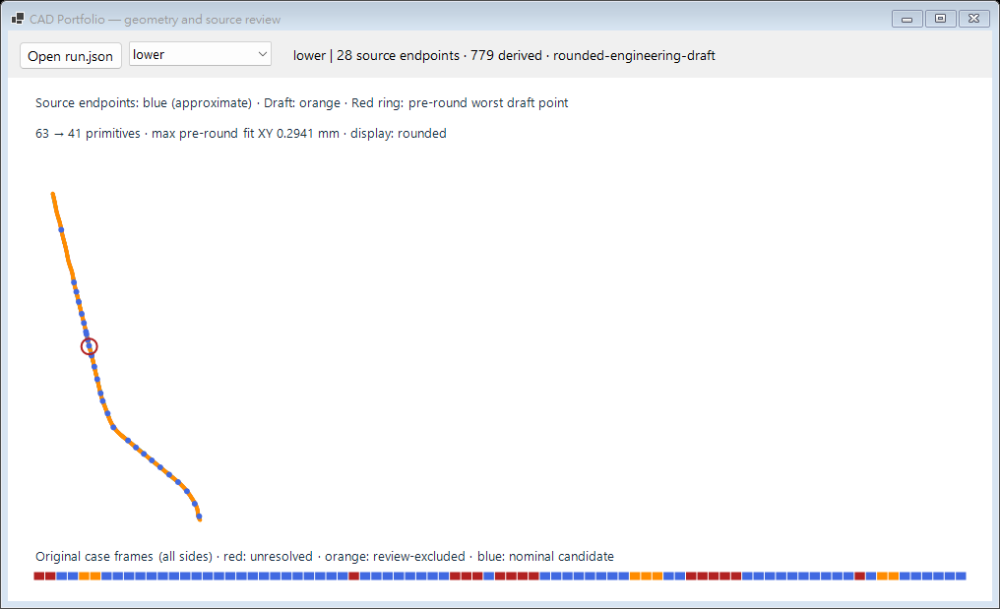

# 接手工程師的五分鐘檢查

接手先照 [快速開始](../README.md#快速開始)跑 `source generate/run/verify`，預期 3/3 工程草稿側線。原件持有人使用同一流程讀本機私有 manifest，見 [Case A](original-case.md#重跑與本機私有資料)。原始支持在 `source-run.json → source.anchors`，衍生草稿在 `draft.sides`，原框未定與排除在 `source.frames`，減段嘗試在 `fitting[].geometry.trials`。全部衍生站都不能冒稱原始觀測。

Windows 也可啟動 Viewer 按 **Create demo** 或 **Build reviewed case**，完成生成、數值核對並開啟結果。新增工作記錄與 GUI／CLI 對照見[操作指南](operator-guide.md)。定位某項技術／歷史決策用[程式地圖](technical-map.md)。

以下 `job.json`／`section` 欄位仍適用於早期解析基準，與新 reviewed-source schema 分開。 [舊懸吊臂回歸](suspension-arm.md)

Viewer 直接標示 `max pre-round fit XY`、`display: rounded` 和紅圈的取整前階段。`overlay.svg` 舊標籤 `max fit XY` 及紅圈仍指**取整前擬合**，彩線在取整通過時顯示取整結果。取整後兩組點距見 `source verify` 的 `cadXYMaximum` 與[獨立重算 PNG](../assets/case-a-fitting.png)。

這是程式實際開啟原件 `run.json` 後繪出的 lower 側；`0.2941 mm` 是取整前擬合，該側最終取整後最大值為 `0.294194 mm`。完整製造貼合另見[貼面案例](surface-contact.md)。開檔驗證現在覆蓋來源／框空元素、空線弧及空擬合元素，錯誤報告在繪圖前拒絕；這不取代完整 `source verify`。

## 哪份檔案回答哪個問題

| 要確認的事 | 檔案及欄位 |
| --- | --- |
| 這次跑的是哪批輸入 | `job.json` 定義側別、導引區間、探測高度和有限 Z 範圍。`run.json` 的 `inputFingerprint` 綁定設定、ASC 和 STL。 |
| 某點是量到的還是推估 | `run.json → sides → stations`。依 `index` 找站位，再看 `state`、`triangles` 和 `cover`。`observed` 可用原始三角面回查。懸吊臂的 `height` 保存來源 Z，`inferred` 的 `sourceState` 保存推估前的未定原因。 |
| 為什麼一側沒輸出 | 查 `verification.json` 該側的 `status`，再回 `run.json` 看 `issue`。`gap` 示範應保留兩側，第二側因缺口而扣留。 |
| 數值在哪一層驗證 | `verification.json` 分開記錄草稿點距、取整位移界、取整後 XY、端點／G1 與有限延伸面的三維樣點距離。 |
| CAD 收到什麼 | `cad-plan.json` 只列通過的側線。座標、半徑和高度以 mm 表示，`sweep` 以弧度表示。從 +Z 看向草圖平面，正值逆時針。Macro 收據把計畫雜湊和草圖身分綁在一起。 |

`verify` 會從來源重播站位及數值檢查，並重新產生預覽供比對。更換換行格式仍可核對。替換圖面內容或缺少檔案會讓驗證失敗。

## 故障從哪裡查

| 現象 | 先查 |
| --- | --- |
| 來源或站位不同 | 確認 `verify` 使用原輸入目錄，再依站位和三角面編號查剖切。 [剖切程式](../src/Core/Scan.cs) |
| 預覽與驗證結果不同 | 用原輸入在新目錄重跑 `run`，再查新的 `overlay.svg`。 [預覽產生器](../src/Core/Drawing.cs) |
| 擬合或取整超標 | 從 `issue` 找失敗階段，對照 `fit` 的最大誤差點及有限曲線距離。 [幾何說明](geometry.md) |
| Macro 回報非預期實線或必要曲線成了施工線 | 對照訊息中的側別與曲線名稱，先在獨立示範草圖重現。計畫內曲線須參與建面，輔助線須標成施工線。 [VSTA 除錯](macro.md) |

修改剖切或擬合後，先重跑正常件，再跑 `gap` 和 `competing` 確認未定站仍能被辨識。修改 Macro 後，至少重跑正常草圖、施工輔助線和意外實線三種原生對照。 [驗收與證據](verification.md)
