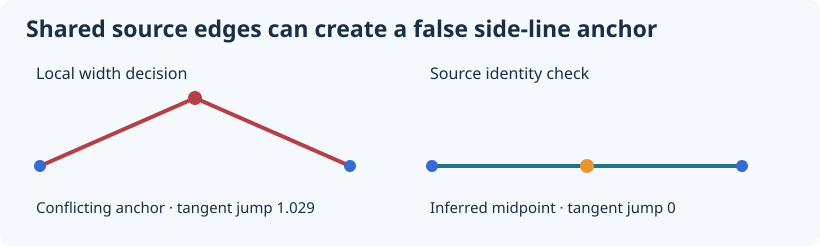

# 混蓋凹折與來源矛盾

**歷史狀態**　正式採用

## 問題

側線局部突然凹陷，需要判定發生在原始點、工程錨點或最後擬合。

## 程式與合成對照

原專案比對相鄰錨點與剖切邊，發現兩個看似不同的蓋候選重用一組原始支持。隔離該錨點後凹折消失。合成例將相同邊 ID 重排，量到拒用前後的切向跳變。

```shell
dotnet src/Cli/bin/Release/net10.0/Cli.dll experiment run mixed-cover
```

輸出 `observations` 列出判定依據，`reproduced` 表示合成對照是否符合預期。 [實作](../../src/Core/Experiments.cs#L135)

## 設計、反例與決策證據

原意是讓每框的較寬蓋提供可靠工程錨點。實際凹折先出現在錨點層，線弧擬合隨後忠實保留它，因此單純換擬合或加平滑沒有解決來源錯誤。

歷史另一掃描件局部相鄰框的錨點 XY 偏移約 0.323／4.969／0.205 mm；加入問題錨點後，局部轉角從原參考的 −8.239° 變成 +43.762°。回查發現名義不同的兩候選共享完整 95 條原蓋支持。只停用該觀測的同版對照，反向凹折不再出現。這是定位機制的局部對照，並未證明整件貼合正確。

後續採用來源身分矛盾防護，拒用矛盾觀測後沿用已授權的工程推估。沒有把無共同邊當作物理不同蓋的證明。現在的 [SourceEvidence](../../src/Core/SourceEvidence.cs)保留完整支持重用與跨側配對矛盾檢查；[來源測試](../../tests/source_acceptance.py)真正送入重用支持，要求輸出未定。

這個歷史凹折數值來自另一件，不能冒稱本次 Case A 的新實測。原始 Case A 的 F37 重用與 F54 切換另外列在[實件圖](../original-case.md#來源與未定狀態)。

在重複完整支持身分時拒用該觀測，依當時已接受的方式列為工程推估。仍有其他側線偏差與實際貼合待核。



[回方案索引](../engineering-decisions.md)

## 現行工程草稿中的角色

先修來源矛盾能避免擬合把凹折保存到 CAD。這比單純加密或壓低數字更接近少返工的目的；局部修復的實證不擴大成全件焊道或工時驗收。 [現行交付判準](../engineering-acceptance.md)。
