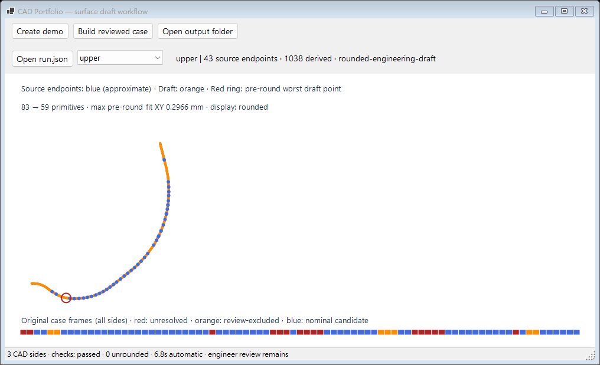

# 從輸入到可微調貼面：操作路徑

目的是讓工程師少做重複描線、約束與建面，先拿到可審看的主要外形草稿。WinForms 現在可以直接建立示範，或從已審查的工件設定產生側線／CAD 計畫、重播數值核對，再開啟結果。原生 CATIA 的草圖與建面由 VSTA 另行執行。

## Windows 不輸入一串 CLI 命令也能重跑

需要 Windows 與 .NET 10 SDK。在儲存庫根目錄啟動：

```shell
dotnet run --project src/Viewer -c Release
```

1. 按 **Create demo**，選放新工作區的位置。程式建立獨立的 `demo-*` 子目錄，內有解析測試件 `input` 與結果 `output`，接著自動開啟圖面。這是公開重跑測試件，外形不是原始 Case A。
2. 用側別下拉選單查看 upper／lower／left、藍色來源端點、橙色衍生草稿與原框狀態。圖上 fit 數字及紅圈屬取整前，`display` 標示實際顯示階段。
3. 按 **Open output folder** 查看 CAD 計畫與驗證記錄。自動執行耗時不含開啟程式、示範輸入製作、人工準備、審看、修改或原生 CAD；不能當作省下的工程師工時。

原件持有人按 **Build reviewed case**，選本機 `case.json`，再選輸入資料夾以外的輸出位置。程式建立新的 `draft-*` 子目錄，原 STL／ASC／設定不被覆寫。這個設定必須已明列網格、參考線、支持域與審查資料，並非任意 STL 自動辨認所有物理壁面的入口。[私有輸入轉接](original-case.md#重跑與本機私有資料)



圖是新介面開啟 Case A 的實際繪製，來源幾何不變。上排按鈕處理整個離線工作，底部將自動執行、數值狀態與工程師審看分開。工作期間維持訊息迴圈，避免視窗被計算卡住。這是公開新寫介面，不是公司原操作程式的完整複製。

## 輸出怎麼讀

| 輸出 | 用途 |
| --- | --- |
| `source-run.json` | 原始支持／來源狀態、衍生草稿、擬合與減段嘗試。 |
| `run.json`、`overlay.svg` | 桌面審閱與 2D 疊圖，格式與 CLI 相同。 |
| `cad-plan.json` | 毫米有限線弧、平面與高度，送給 VSTA。含實件座標時留在本機。 |
| `source-verification.json` | GUI 額外保存的 `SourceVerification` 結果；CLI `source verify` 則印在標準輸出。 |
| `workflow-run.json` | 執行狀態、CAD 側數、未取整側數、自動計算耗時；明列未執行原生 CAD、未量測人工省時。 |
| `numeric-verification-error.txt`／`workflow-error.txt` | 核對或建構失敗的本機診斷，保留供追查。 |

`draft-created` 只表示有工程 CAD 草稿；`numericStatus: passed` 表示既有數值重播契約完成，還要看各側 `roundingState`。例如固定首尾的一條線無法同時將長度取至 0.01 mm 時，既有核心可保留明示的未取整工程草稿，介面另列 `unrounded` 數量。這不會被寫成「取整通過」。

`needs-review` 表示數值核對沒有成功，已產生的資料保留供診斷，不把它改標通過；`failed` 表示建構停止。若關閉視窗或系統中斷時記錄仍是 `running`，該次工作不能當完成收據，重新選新輸出目錄執行。現有輸出、輸入資料夾及壞來源指紋會被拒絕。[介面程式](../src/Viewer/Program.cs) · [流程接頭](../src/Viewer/DraftWorkflow.cs) · [實際回歸](../tests/viewer_workflow.py)

## 交給 VSTA 與工程師

1. 用同一份 `cad-plan.json` 依 [VSTA 手冊](macro.md#在-vsta-編輯器建置與執行)建立獨立測試庫、編輯／建置／F5。GUI 沒有自動啟動授權宿主，也沒有將離線生成冒充原生執行。
2. 由工程師看主輪廓、肩部／端部及焊道細節，記需要改的區域和操作。精度供診斷，工程草稿不以全點低於 0.3 mm 作總門檻。
3. 公開 Macro 的精確計畫會拒絕不相符的手調草圖；手調後的新計畫／驗證接續仍待補。不能沿用原收據宣稱修改後也已驗證。[交付判準](engineering-acceptance.md) · [已知缺口](completeness-audit.md)

Linux 讀者沿用 [CLI 快速開始](../README.md#快速開始)；幾何與驗證共用同一核心。無私有原件的讀者可完整跑解析 fixture，不能重播 Case A 的私有座標。
