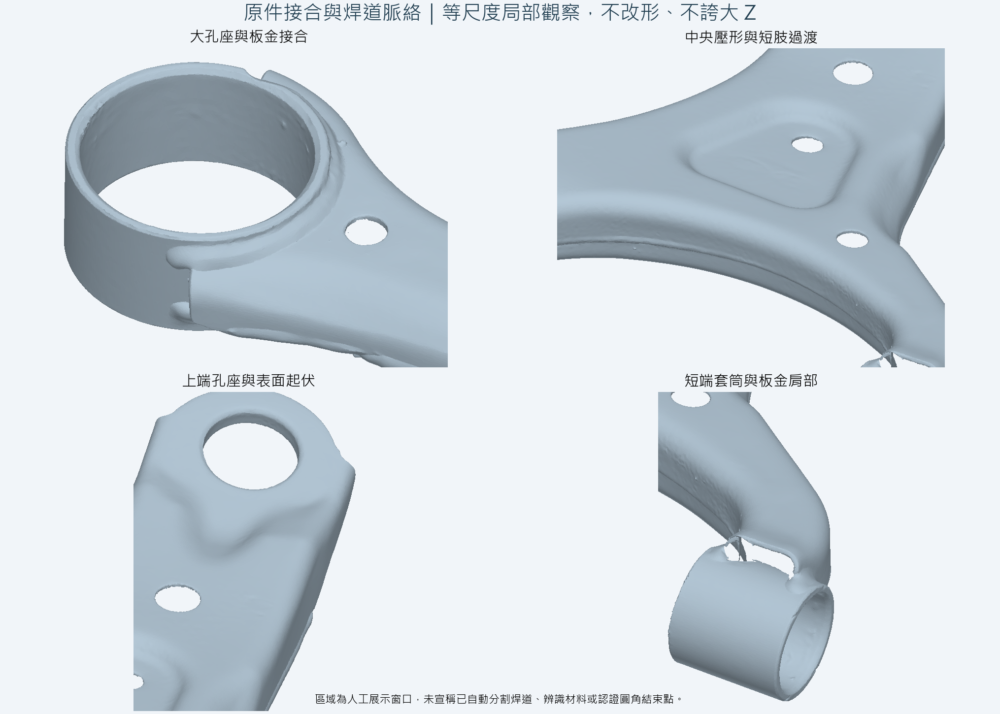
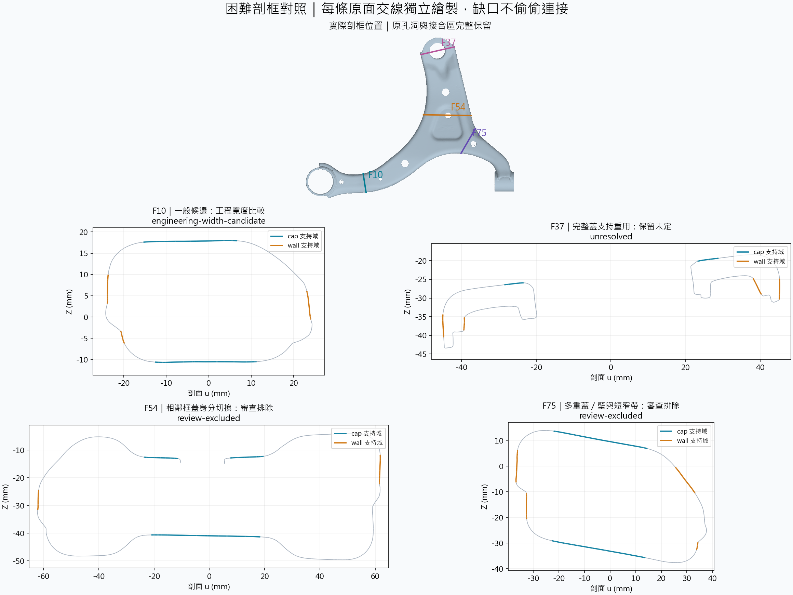
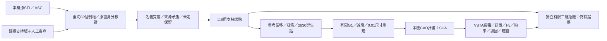
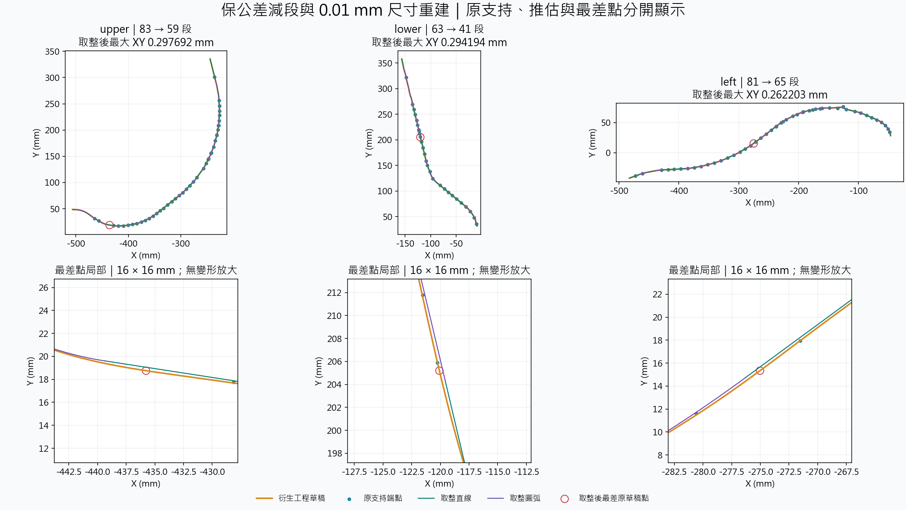

# 原始 Case A：完整流程與工程限制

採未修改的第一號掃描，沒有改孔洞、縮短肢體、平滑板金或重建外緣。公開的是重新繪圖、獨立新寫程式及彙總數據；原 STL／ASC、公司 C#／DLL、支持 JSON、CAD 與完整日誌均留本機。Case A 是去識別代號，不為原件另行推定品牌、車種或用途。曾嘗試的改形版本已因孔形／板金／接合過渡不符需求而撤回。



掃描中的接合帶、焊道起伏、短壁和孔座會一起進入剖框，不能把所有局部凸起都當同一物理特徵。圖中窗口為人工展示位置，沒有改網格，也沒有假稱程式已自動分割焊道。

## 來源與未定狀態

原件 342,369 三角面。83 個有界剖框各保存平面、局部 u 區間、來源面序、蓋／壁支持域及審查狀態。從不變形的 STL 重新求交，核對有限交線與支持端點，最大來源殘差 `5.684341886080802e-14 mm`，低於既有 `1e-7 mm` 算術身分界。

`source.frames` 的 `intersections`／`components` 是完整平面求交的診斷數；供應支持依原有界u區間裁切後再驗身分，剖框圖也只畫有界交線。這兩種範圍不混用來推導缺口或物理接受率。

| 資料層 | 本次數量與含義 |
| --- | --- |
| 工程寬度候選 | 60 框。精確比較名義延伸寬度，不等於物理同蓋認證。 |
| 審查排除 | 7 框。已知跨框支持身分切換列為輸入審查，不硬寫進通用演算法。 |
| 未定 | 16 框。缺支持、重用整組支持或順序／寬度未決，保留原因。 |
| 原支持端點 | upper 43／lower 28／left 48，共 119。近似工程錨點，並非認證的圓角結束首點。 |
| 衍生草稿 | upper 1,038／lower 779／left 1,013，共 2,830 點。插值、端部推估與取樣均標明衍生。 |



- **F10**：一般框仍需比較兩組蓋壁跨度。較寬只產生工程候選。
- **F37**：兩入口重用同一完整蓋支持，候選名字不同不代表兩塊獨立蓋。
- **F54**：相鄰框最大寬度涉及蓋位置切換，單框最大 W 不能證明整線同蓋。
- **F75**：上斜段、短窄轉折與另一較直壁並存；連通或短窗直度不能單獨證明目標壁。

公開流程接收**已歸檔支持域**，再驗原面／原交線、相對順序與身分矛盾，沒有聲稱從任意未知 STL 自動發現並認證物理蓋壁。歷史支持搜尋與單／雙／三弧探索的最小反例見[歷史庫](engineering-decisions.md)。

## 工程草稿



P1／P2 依原參考折線的最近有限投影分側；範圍是**參考線弧長站距**，不是世界 X／Y。upper 全段、lower 0–370 mm、left 0–480 mm，是既有工程確認，不是自動套筒分類結果。範圍外支持不補回。

選壁支持中靠近蓋支持線的原端點作近似錨點，計算相對參考足點的 XYZ 偏移。同站取中位數、站間線性插值、端部保持端值，再以自然三次樣條通過工程節點，依三維弧長約每 0.5 mm 等分。原始缺口仍在來源層，衍生草稿的連接明示為推估。

凍結歷史草稿只作獨立對照，未被讀入生產流程。三側點數相同，最大座標差 upper `7.11e-15`、lower `1.21e-13`、left `7.35e-14 mm`，均在原 `1e-7 mm` 算術界內。這證明重現既有草稿語義，不能證明物理首點正確。 [工程草稿](../src/Core/EngineeringDraft.cs) · [樣條與等分](../src/Core/ReferenceGeometry.cs)

## 線弧與取整實測



以有限弦支持建立有序節點，加入相切圓弧，再逐個移除內部支持。每次重建對全部原草稿點及 0.5 mm XY 等分點量有限線／有號弧距離；超過 0.3 mm 或失去端點／G1 即拒絕。接受／拒絕均存於 `fitting[].geometry.trials`。最多 8 輪／2,000 次，預算到達與全域最少各有欄位。 [一般擬合實作](../src/Core/GeneralFitting.cs)

| 判準 | upper | lower | left |
| --- | ---: | ---: | ---: |
| 基準 → 減段元件 | 83 → 59 | 63 → 41 | 81 → 65 |
| 減段原草稿 XY 最大（mm） | 0.296583 | 0.294134 | 0.258049 |
| 減段 XY 等分最大（mm） | 0.296524 | 0.294106 | 0.257958 |
| 取整後兩組 XY 最大（mm） | 0.297692 | 0.294194 | 0.262203 |
| 獨立取整位移上界（mm） | 0.008787 | 0.004678 | 0.022314 |
| 首尾最大殘差（mm） | 2.84e-14 | 1.75e-14 | 1.35e-13 |
| 接點殘差（mm） | 0 | 0 | 0 |
| 切向單位向量差 | 4.35e-14 | 4.62e-14 | 6.84e-14 |

線長與弧半徑取至 0.01 mm 後重建，保持有號方向，再獨立核對位移界 ≤ 0.05 mm 與 XY／G1。原草稿點與等分樣點是離散單向檢查，**不是連續雙向 Hausdorff 證書**。 [獨立驗證器](../src/Core/SourceVerification.cs) · [完整彙總](evidence/case-a-geometry.json)

歷史版 61／27／41，共 129 段，草稿 XY 為 0.255364／0.340447／0.495341 mm。新引擎 227 → 165 段均過 0.3，比歷史多 36 段。基礎是同一凍結草稿與公差；引擎不同，不能宣稱段數全面勝出或全域最少。

## 三維貼合尚未合格

三側面的原件疊合、最差點與真實法向剖面、全部 119 個支持端點的距離已集中在[貼面案例](surface-contact.md)。原件外形與原生已驗證的線弧／高度保持，圖面重繪不等於另一次原生接觸驗收。

本次原支持錨點到取整有限面的最大距離 0.279204／0.698534／1.799857 mm，後兩側超過 0.3。歷史原生對較完整原壁支持交線端點為 0.664812／1.074918／1.843587 mm，也未過。取樣域與版次不同，不算改善百分比。

實際物理接觸帶尚未固定；兩組都不是全 STL 最大表面距離。下一工程問題是確認接觸域及修橫向側線，本輪未調原 STL、Z 高度或公差換通過。CAD 建面／讀回不能取代製造貼合驗收。

## 重跑與本機私有資料

一般讀者照 [README](../README.md#快速開始) 生成獨立解析 shell-strip 測試件：3,264 面、66 框、3 個刻意排除框，每側 13 → 11 段。用途是公開重跑同一來源、草稿、一般線弧、取整及驗證程式，外形不是原件。

原件持有人用本機支持匯出轉接：

```shell
python tools/import_reviewed_case.py path-to-local-config.json artifacts/private-case --mesh path-to-local-original.stl
dotnet src/Cli/bin/Release/net10.0/Cli.dll source audit artifacts/private-case/case.json artifacts/private-audit
dotnet src/Cli/bin/Release/net10.0/Cli.dll source run artifacts/private-case/case.json artifacts/private-result
dotnet src/Cli/bin/Release/net10.0/Cli.dll source verify artifacts/private-case/case.json artifacts/private-result
dotnet src/Cli/bin/Release/net10.0/Cli.dll source public-report artifacts/private-case/case.json artifacts/private-result artifacts/public-summary.json
```

轉接器核原 SHA、支持邊與面序，只複製至 git 忽略路徑或庫外。私有 `case.json` 明列三個參考點檔及 SHA、每框平面／u 範圍／原面序／支持域與審查原因；相對路徑依 manifest 目錄解析。CAD 計畫含實件座標，同樣不公開。

`source public-report` 重新完整驗證後只輸出固定彙總欄位，去除路徑、座標與框資料，側別使用通用代號。圖由[本機繪圖程式](../tools/render_source_case.py)重畫成 PNG，仍展示使用者選定的實際外形，原資料不放 GitHub 或 Release。

私有原件PNG繪圖器目前讀binary STL，本機實測Python3.14.2／NumPy2.4.0／Matplotlib3.10.8，選配依賴列在[requirements-render.txt](../tools/requirements-render.txt)。一般讀者不需安裝這些套件，公開fixture由CLI直接產生SVG。繪圖的`--report`會對同一輸入指紋核對獨立C#彙總，避免圖面與驗收數字脫節。

| 症狀 | 處理 |
| --- | --- |
| 指紋不符 | 找原版本，不直接改 SHA 繞過。 |
| 支持不在有限邊／帶內 | 查原支持、平面與局部 u 位移，先修來源。 |
| 平手或支持重用 | 留未定；候選名稱不是物理身分。 |
| 擬合／取整未過 | 看 `fitFailure`／`roundingFailure`。未取整工程草稿另有明確 stage，不能冒稱取整通過。 |
| Viewer 開不了 | 選 `run.json`；`cad-plan.json` 給 Macro。 |
| 輸出已存在 | 換新目錄，保留舊證據。 |

[幾何推導](source-geometry.md) · [VSTA](macro.md) · [驗收](verification.md)
