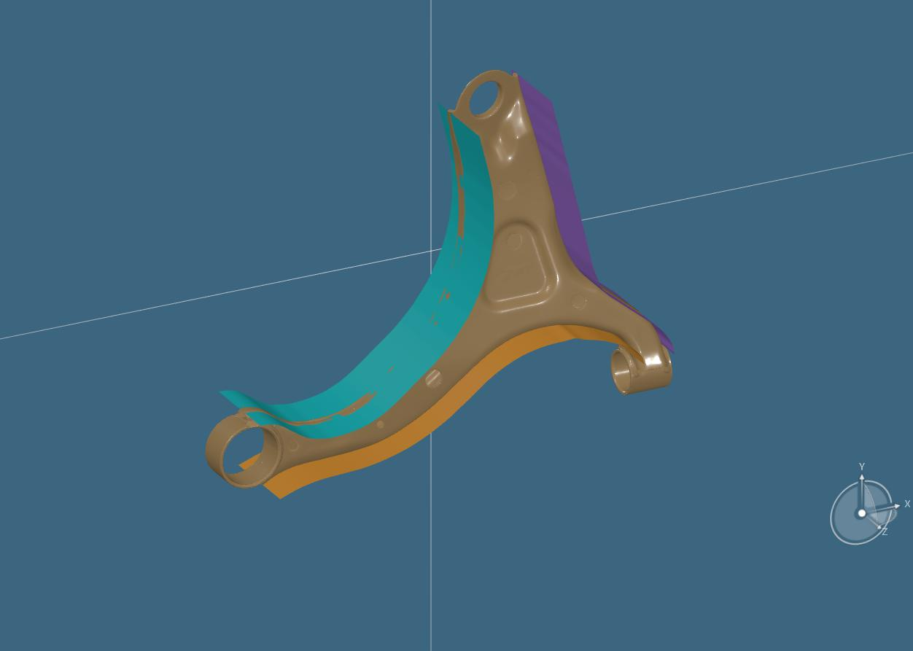
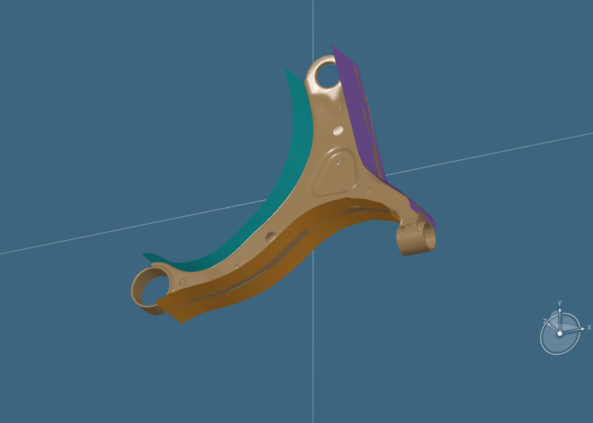

# 從去焊道側線到有限貼面草稿

本頁詳細說明**側線線弧延伸**。歷史專案另有「選取點群→程式自動擬合局部平面」，中央板面、孔座與肩部的原生圖已補在[兩種貼面方法與圖解](surface-methods.md)及[完整圖集](surface-gallery.md)；不要把兩種面或不同版次的證據混用。

這個專案要交給工程師的是**沿板金側邊建立的可編輯貼面草稿，減少人工描線與建面，並以簡化難加工焊道細節為目標**。主要看輪廓是否可用、需改多少、流程是否省時；面的位置、高度與距離用來引導工程審看。

目前已實跑原生建面與幾何讀回，焊道區域的工程接受、剩餘手調及工時對照仍待補。**0.3 mm 是既有接觸診斷參考，不是工程草稿的唯一成敗門檻。** 舊製造接觸結果保留，不改寫成通過。[現行交付判準](engineering-acceptance.md)

## 本次 CATIA 原生同場展示





兩張均由 CATIA `Viewer.CaptureToFile` 直接匯出，隱藏樹狀身分，沒有修改像素。金色是掃描，青／紫／橙依序是 upper／lower／left。這是側邊有限延伸面，不是把中央板面或整件板金重新建完；歷史局部平面擬合另見頁首入口。相交、遮蔽及近共面交錯不代表零間隙，也不代表已修剪縫合。

**判準 → 實測 → 來源**：同一計畫與來源 SHA；3 草圖、165 元件、405 有效約束、3 個 Z±50 mm 面，讀回殘差 ≤1e-7 mm。2026-11-08 在現有獨立測試庫 Build 成功、0 錯誤／0 警告後，設為啟始專案並按 F5；`DSYVstaDebugHost`／`CATMain` 執行完成。掃描貼入後再次沿同一 `ReadBack` 核對，最大殘差仍為 8.952838470577262e-13 mm。[當次去識別收據](evidence/case-a-native-codisplay-20261108.json)綁定兩圖 SHA；完整宿主日誌、計畫及掃描留本機。

掃描由原參考件 **Copy → 新驗證件 → Paste Special／As Result**，沒有執行平移、縮放或變形。來源與副本 Properties 均顯示 342,369 三角面、174,743 點、40 邊界，相同包圍盒；本機原 STL 的包圍盒與原生顯示值在 0.001 mm 的顯示核對界內。這是操作來源與統計核對，**尚未逐三角座標匯出比較**；不能僅由點數或圖片證明完整模型逐座標相同。原參考件的名稱／集合數快照保持，並非完整模型完整性證書。

本輪只補原生執行與展示，不改原 STL、幾何核心或公差。CATIA 顯示過本機保存成功提示；未執行或確認 PLM 保存／關閉重開。全區焊道處理、剩餘手調與工時仍需工程確認；下方距離圖保留原數值，不以本次畫面改寫接觸狀態。

## 面貼在哪裡，解決什麼問題


灰色是原始 Case A，孔洞、焊道、板金、短肢與套筒全部保持。青色 upper、紫色 lower、橙色 left 是三側線弧沿 Z = -50～+50 mm 的有限延伸面。圓點是原支持端點的前景標記；紅點超過 0.3 mm。圖面是**原網格與原生已驗證計畫的同座標重繪**，不是把 CATIA 面的照片貼到另一張零件照片，也沒有為了看起來貼合而移動掃描。

含焊道的原始外緣不能直接被視為理想建模邊界，剖框也可能選到不同蓋。流程先保存原交線、來源面與缺口，再用已歸檔支持域和審查決策產生近似錨點與明示推估的側線；以有限直線／圓弧減少 CAD 編輯元件，建立有端點、相切和半徑約束的草圖，最後延伸成面。用途是縮短工程師建立草稿的路徑；尚未實測節省工時。

這些面沿側邊延伸；原掃描的焊道保留作對照，工程面則不要求逐一複製會增加加工困難的凸起和細碎轉折。是否避開了正確區域仍需工程確認。較寬蓋、物理壁與圓角後首點有未定與人工審查範圍；不能由圖片倒推全自動焊道分類已成功。[原件難例與來源邊界](original-case.md#來源與未定狀態)

## 線如何變成面

| 步驟 | 幾何／程式 | 可以核對什麼 |
| --- | --- | --- |
| 保來源的工程側線 | [SourceEvidence.cs](../src/Core/SourceEvidence.cs)、[EngineeringDraft.cs](../src/Core/EngineeringDraft.cs) | 83 框、119 原支持端點、2,830 衍生草稿點分開保存；缺口和未定有紀錄。 |
| 有限線弧與尺寸重建 | [GeneralFitting.cs](../src/Core/GeneralFitting.cs)、[MultiBendFitting.cs](../src/Core/MultiBendFitting.cs) | G1 相切、正負弧向、0.01 mm 線長／半徑重建；取整後草稿 XY 三側均 ≤0.3 mm。 |
| 原生約束草圖 | [MacroWorkflow.cs](../macro/MacroWorkflow.cs) | VSTA 編輯器 Build／F5：59／41／65 元件、405 有效約束，最大讀回殘差 8.95e-13 mm。 |
| 有限延伸特徵 | 同一 Macro 核對指紋與所屬草圖後建面 | 3 個延伸特徵、平面 Z=0、Z[-50,50]。同一 [VSTA 收據](evidence/case-a-vsta.json)綁定計畫 SHA。 |
| 面的距離 | [SourceVerification.cs](../src/Core/SourceVerification.cs) | 點到有限線／有號有限弧，再加上超出高度的距離；不是點到無限直線或整個圓。 |

對每條有限線弧 c(t)，延伸面為 S(t,z)=(cₓ(t),cᵧ(t),z)，t 僅在該線段或有號弧掃掠內，z∈[-50,50]。計算 P 到整側所有有限面的最近距離：

```text
dXY = min(點 Pxy 到每條有限直線／圓弧的距離)
dZ  = max(0, zMin - Pz, Pz - zMax)
d3D = sqrt(dXY² + dZ²)
Qz  = clamp(Pz, zMin, zMax)
```

這個分解成立是因為所有線弧共享同一有限 Z 區間；不能直接套到任意自由曲面。線段垂足超界要夾到端點；圓弧徑向垂足超出有號掃掠時，要比較兩個弧端點。正負弧向和有限高度控制見 [surface_display.py](../tests/surface_display.py)。

## 局部看貼面差在哪裡


上排窗口各為 24×24 mm 的等尺度投影。下排剖面通過原支持點 P、面上最近點 Q 及 Z 方向，灰線由原始 STL 三角面重新求交；彩色豎線是該垂足處的有限面截線，紅線長度就是量到的縫隙。下排局部範圍依側別不同，坐標軸及 0.3 mm 參考尺均明示；每個窗口的水平／垂直比例相同。這些法向診斷剖面與原本 Fxx 的採樣剖框不是同一個切面。

顯示用弧面以弦高不超過 0.02 mm 的小片繪製，影像排序仍是示意渲染；**量測使用解析有限線弧**，不拿顯示三角片當驗收面。支持點與垂足為前景標記，判讀真實縫隙以解析數字和下排截線為準。

## 全部樣點與判準


本表保留原試驗對**原支持錨點子域**採用的 0.3 mm 距離參考；在現行工程草稿交付中，它提供偏差位置，不作整個專案的成敗結論。獨立 Python 垂足計算與既有 C# 最大值的差不超過 7.9e-15 mm，小於核對界 1e-7 mm；數字沒有因目標調整而改寫。

| 側別 | 原支持點數 | 高於 0.3 mm 參考 | 最大距離（mm） | 最差框 | 診斷 |
| --- | ---: | ---: | ---: | --- | --- |
| upper | 43 | 0 | 0.279204 | F27 | 本次樣點均在參考內 |
| lower | 28 | 3 | 0.698534 | F63 | 局部供工程審看 |
| left | 48 | 3 | 1.799857 | F74 | 局部供工程審看 |

這 119 點均在 Z[-50,50]，所以這批樣點的 dZ=0，偏差來自橫向位置。這只描述這批點，**不代表全部板金或焊道皆有高度覆蓋**。工程審看應判斷主要輪廓、需避開的焊道及剩餘修改；若另做精密接觸驗收，再固定對應接觸帶與公差。不能將未取樣區域直接標成已接受。

歷史另一版原生面對較完整原壁支持端點的最大值為 0.664812／1.074918／1.843587 mm，也未過 0.3；幾何版次和樣點域不同，不能用這張表計算改善百分比。[驗收分層](verification.md) · [本次彙總](evidence/case-a-surface-contact.json)

## 與真正 VSTA 畫面如何對照


這張是 2026-11-05 由 CATIA 直接匯出、未修改像素的歷史視埠：當時測試 Part 只建草圖與延伸面，單看此圖無法判斷貼合位置。2026-11-08 以同一計畫重新 F5，並將掃描副本貼入新件；本頁上方兩張新增原生視埠補上同場資訊。兩次收據分開保留；本輪沒有新增原生接觸量測或製造驗收。[VSTA 實跑與除錯](macro.md)

## 如何重跑圖和距離

一般讀者可直接執行無私有資料、無繪圖套件相依的控制：

```shell
python tests/surface_display.py
python tests/case_a_evidence.py
```

原件持有人在完成 `source run`／`source public-report` 後，以相同計畫重繪：

```shell
python -m pip install -r tools/requirements-render.txt
python tools/render_surface_contact.py artifacts/private-case/case.json artifacts/private-result artifacts/private-figures --report artifacts/public-summary.json
```

程式先核 mesh SHA、計畫 SHA、來源指紋與完整 CAD 計畫一致性，再計算全部樣點；任何側最大值與 C# 彙總差超過 1e-7 mm 即停止。輸出三張 PNG 與固定欄位的 `case-a-surface-contact.json`；審查後只發布圖及彙總，原件、座標計畫和支持域留本機。[繪圖程式](../tools/render_surface_contact.py) · [獨立垂足計算](../tools/contact_geometry.py) · [公開分界](publication.md)
