# 貼面的方法與工程圖解

貼面的工作，是把含焊道、孔洞、凸台與折彎的掃描，轉成工程師能接著編輯的簡潔幾何。專案有兩條不同的做法：**選取局部點群，由程式自動擬合平面**；以及**沿板金側邊產生相切線弧，再延伸成面**。前者補足局部板面與方向，後者表達連續側邊輪廓。兩者都以減少重複建模、保留主要形狀為目的。

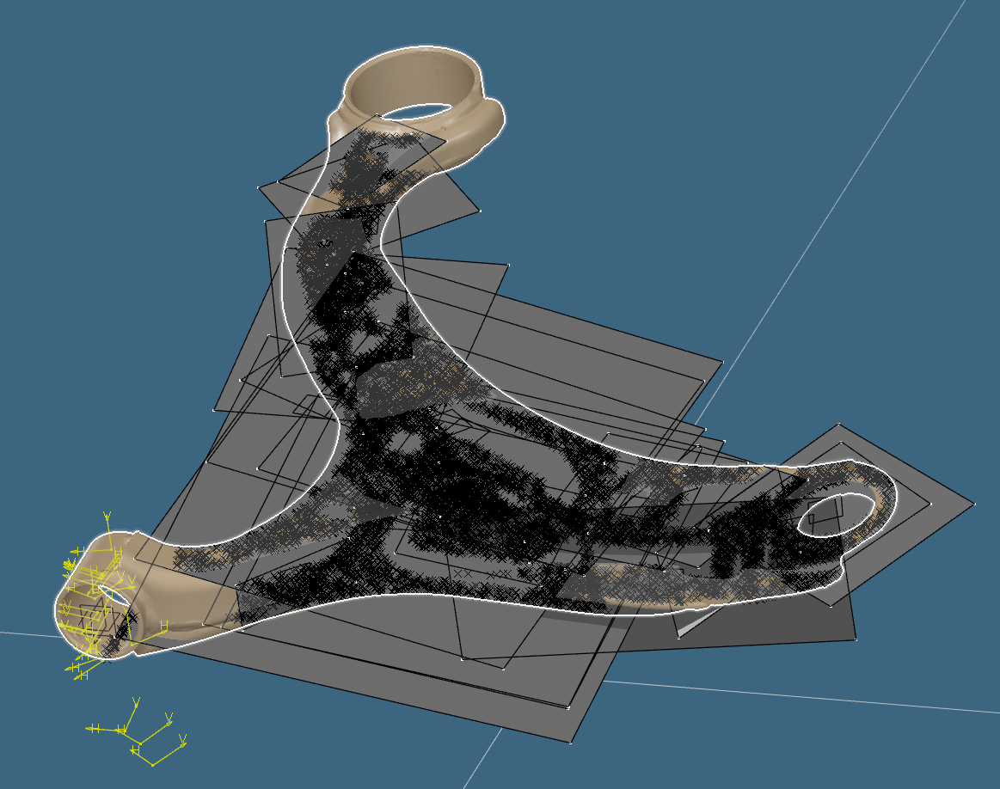

圖為使用者提供的歷史 CAD 視埠，原圖未改像素。可看到多個局部矩形面、點群、孔座與分支一起顯示；它呈現的是**分區建面工作**，不等於所有面已修剪、接合或達到製造接觸要求。這張圖也不是本庫三側延伸面的同一版次。[完整 18 組／59 張對照](surface-gallery.md)

## 先看兩條方法怎麼分工

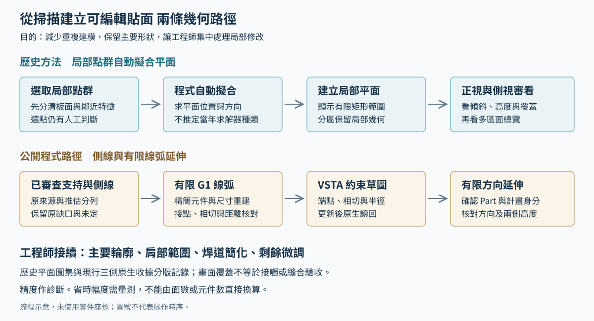

[另開流程大圖](../assets/surface-method-flow.svg)

| 方法 | 輸入與幾何輸出 | 適合解決的工作 | 本庫可核對範圍 |
| --- | --- | --- | --- |
| 局部點群自動平面擬合 | 選取的三維點群 → 有方向與位置的局部平面 | 中央板面、長肢／短肢板面、孔座附近等局部區域，減少逐一手動定平面 | 使用者確認操作方法；附件保留多區、正側視及總覽。當年求解器與原程式尚未逐檔對應，這裡不冒稱已有公開可重跑的平面擬合器。 |
| 側線線弧延伸 | 已審查支持與明示推估側線 → 有限相切直線／圓弧 → 延伸面 | 沿彎曲側邊產生可修改的輪廓，避免逐點複製細碎起伏 | 本庫 C#／VSTA 原始碼、離線示範，以及同一計畫的 Case A 三草圖／三面原生收據。 |

歷史圖集只有「第1」至「第19」中的 18 組編號，缺第10；編號是圖片組別，**不是工件數、獨立平面數或操作的先後順序**。本頁按工程問題整理閱讀方法，不從圖號推定製作時序。

## 方法一 選點後由程式自動擬合局部平面

**已確認的歷史操作是依選取點自動擬合平面。** 點群決定平面應貼近哪一區，程式求平面的位置與方向，CAD 中以有限矩形範圍呈現。工程師可再從不同角度檢查它與板金的關係。點域如何取得及自動化程度尚未核實，不能寫成已證實的手動選點或任意掃描全自動區域辨識。

### 從區域到平面

1. **選定要處理的局部區域**：分清中央凸台、長肢板面、短肢肩部與孔座附近。孔洞沒有實體表面，套筒與板金也不應混為同一片平面。
2. **提供該區點群**：圖中的黑色叉記顯示點的分布。點群位置是判讀重點，密集並不保證選對區域；跨過折彎、孔邊或焊道時，應先審查輸入的物理意義。
3. **由程式自動求平面**：產生平面方向與位置，省去重複手動定面。附件沒有保存求解公式、權重或剔除規則，因此不把它具體寫成 PCA、最小平方法或 RANSAC 的歷史實作。
4. **查看有限面範圍與正側視**：矩形外框是平面的顯示／建模範圍，不是自動取得的板金真實邊界。需要同時看覆蓋區、傾斜及高度，不能只看正視圖。
5. **分區重複並審看整體**：每區面服務於局部幾何；總覽用來檢查位置與覆蓋關係。後續是否修剪、接合、修改或捨棄某片面，要依實際用途決定。

上述步驟是對已確認操作及圖中現象的工程說明；附件未提供每步的操作日誌或工時。

### 平面的幾何怎麼理解

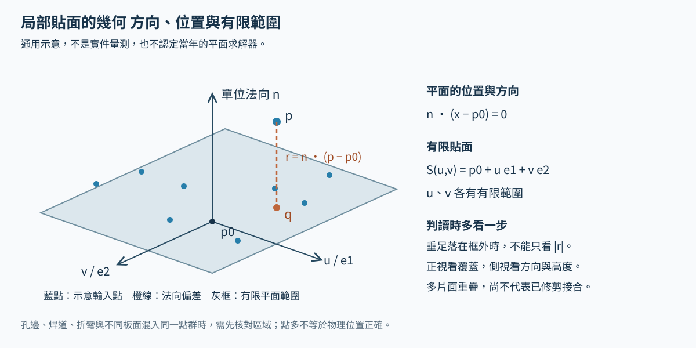

[另開平面幾何大圖](../assets/local-plane-geometry.svg)

用面上一點 `p0`、單位法向 `n` 及互相垂直的面內單位方向 `e1`、`e2`，可以描述局部平面：

```text
Π: n · (x - p0) = 0
S(u,v) = p0 + u e1 + v e2
u ∈ [uMin,uMax], v ∈ [vMin,vMax]

有號法向偏差 r = n · (p - p0)
無限平面垂足 q = p - r n
```

這是平面的通用幾何表達，**不是對當年求解器的反向認定**。它解釋了為何要同時看平面方向、位置與範圍。若 `q` 落在有限矩形外，`|r|` 便不是到該有限面的最近距離；還需考慮面內邊界。若點群接近一條線，單靠它也不足以穩定決定貼面方向。

### 四種局部問題用原圖看

**中央凸台與周圍板面。** 小範圍可對應中央局部特徵，大範圍則同時涉及周圍不同高度。面穿過工件後的金／灰色分布，可以幫助找需要側視檢查的位置，不能當成接觸面積或零偏差證書。

| 局部點群與面 | 擴大區域的對照 |
| --- | --- |
| 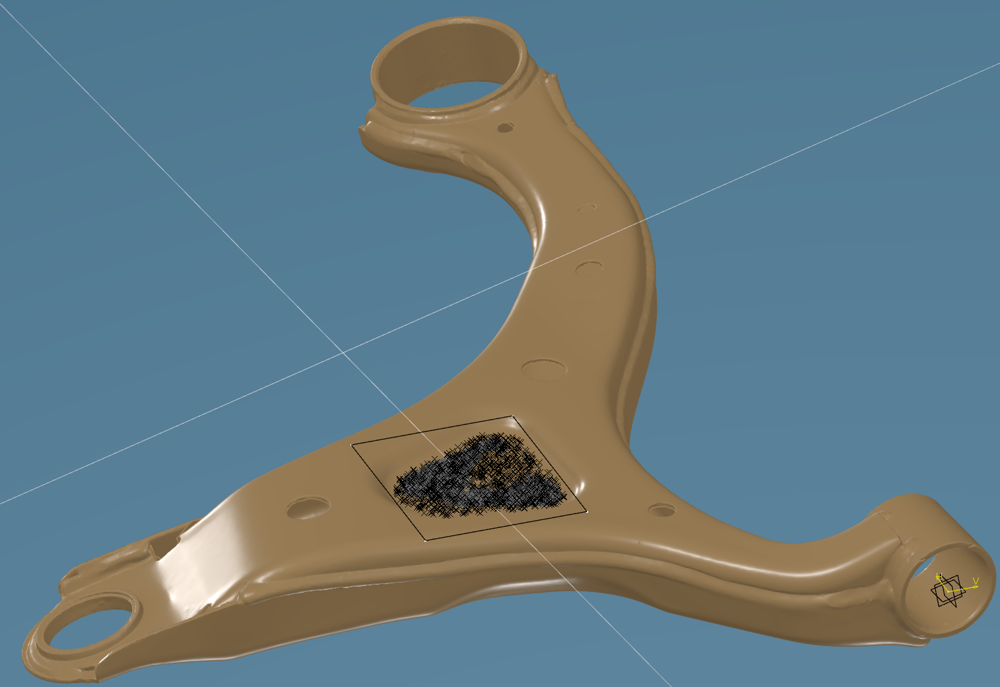 | 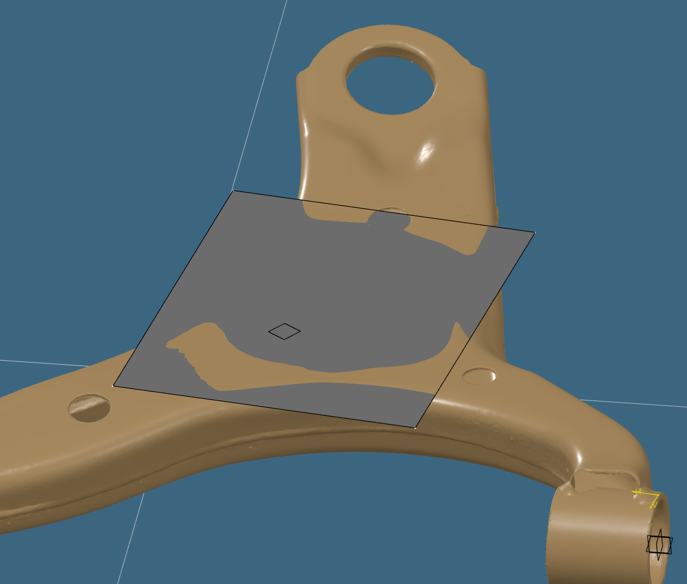 |

**長肢板面與焊道附近。** 正視能看區域覆蓋，側視才容易看出傾斜與板面高度的關係。焊道及邊緣起伏仍保留在掃描中；目標是取得可用的簡潔建模面，不要求逐一複製所有凸起。

| 區域視圖 | 同組側視 |
| --- | --- |
| 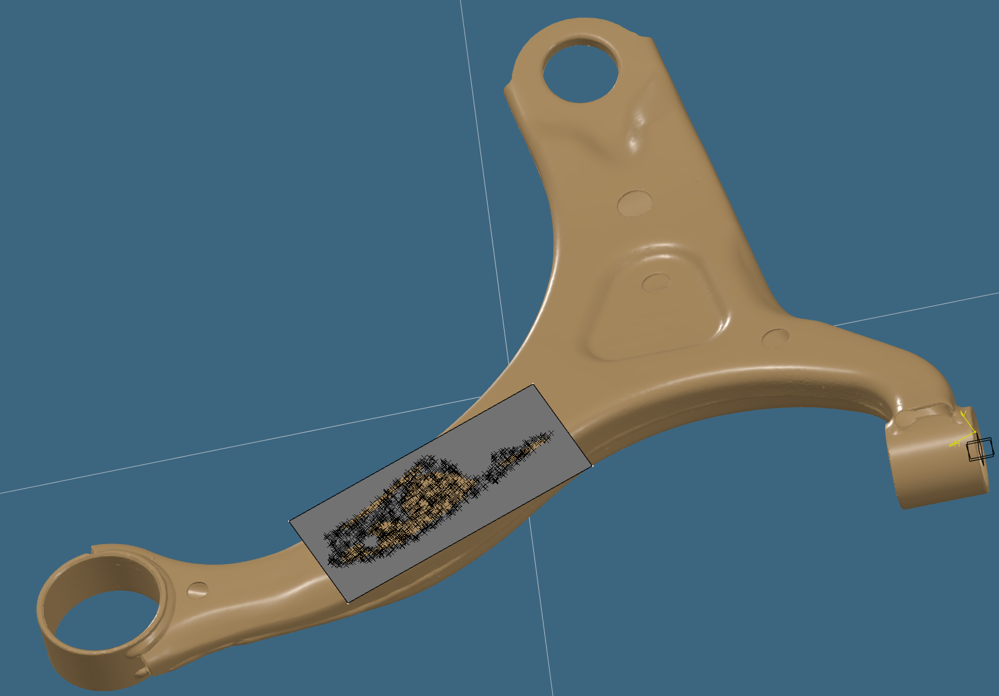 | 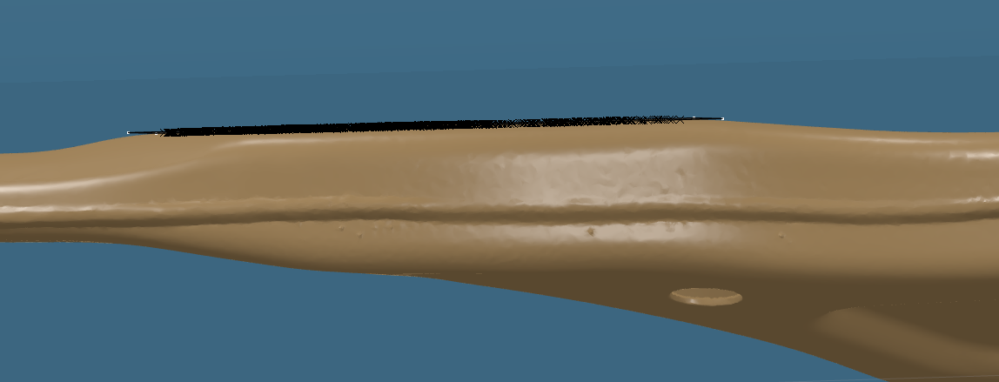 |

**孔座與板金過渡。** 圓孔、翻邊及周圍板面並不共面。局部矩形面可用來表達附近板面方向，但畫面中蓋住孔洞，不代表已建好孔壁或保留了孔的拓撲；套筒本體另按正向建模處理。

| 點群與局部面 | 同組側視 |
| --- | --- |
| 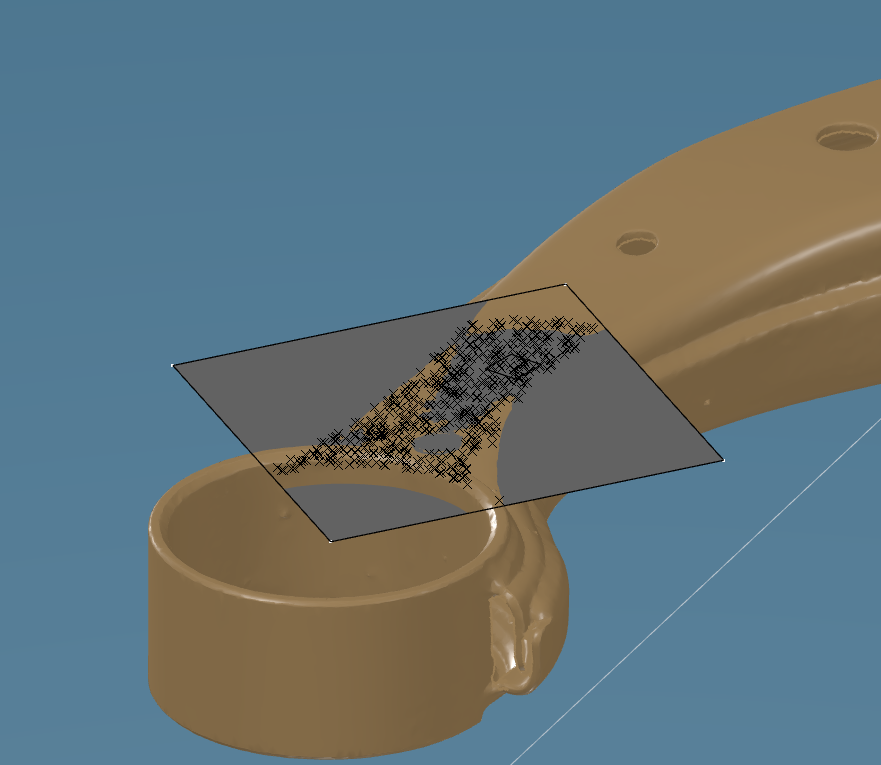 | 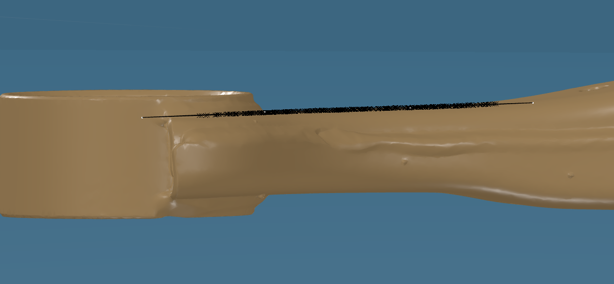 |

**短肢肩部與接合區。** 可用點域小，又接近圓角、焊接及方向改變處；只從正視看似接近，仍可能有方向錯誤或局部穿出。圖集保留了區域、側視及隱去點群後的面，方便逐一比較。

| 點群與局部面 | 同組側視 |
| --- | --- |
| 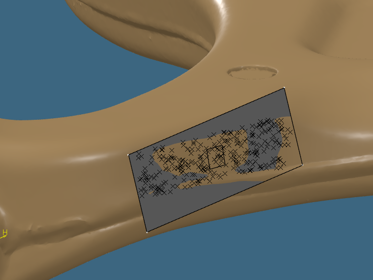 | 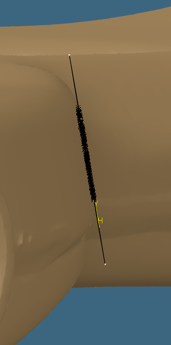 |

## 方法二 側線變成相切線弧再延伸成面

這條路徑處理連續側邊外形。先保留原交線與來源，依已審查支持建立工程側線，缺資料處明示推估；再用有限直線／圓弧表達輪廓，建立可編輯草圖與約束，最後沿指定方向有限延伸。

1. **剖切與來源核對**：三角面／平面求交、共端點組串，保留原面 ID、缺口及未定支持。來源選錯造成的凹折，不靠平滑掩蓋。
2. **建立側線與線弧**：沿站距產生有序衍生草稿，核對有限點距與 G1 相切，減少細碎元件；尺寸取整後重建幾何並再次核對。
3. **VSTA 建可編輯草圖**：建立有限線段與有號圓弧、端點接續、相切及半徑驅動約束。更新後讀回幾何和約束狀態。
4. **核對身分再延伸**：確認同一計畫、正確 Part／草圖與讀回收據，設定方向和兩側高度，建立延伸特徵並核對其有效性。
5. **工程師審看並接續**：看主要輪廓、需簡化的焊道與肩部範圍，再作局部修改。手調後須有新幾何身分與新驗證，不能沿用修改前的成功收據。

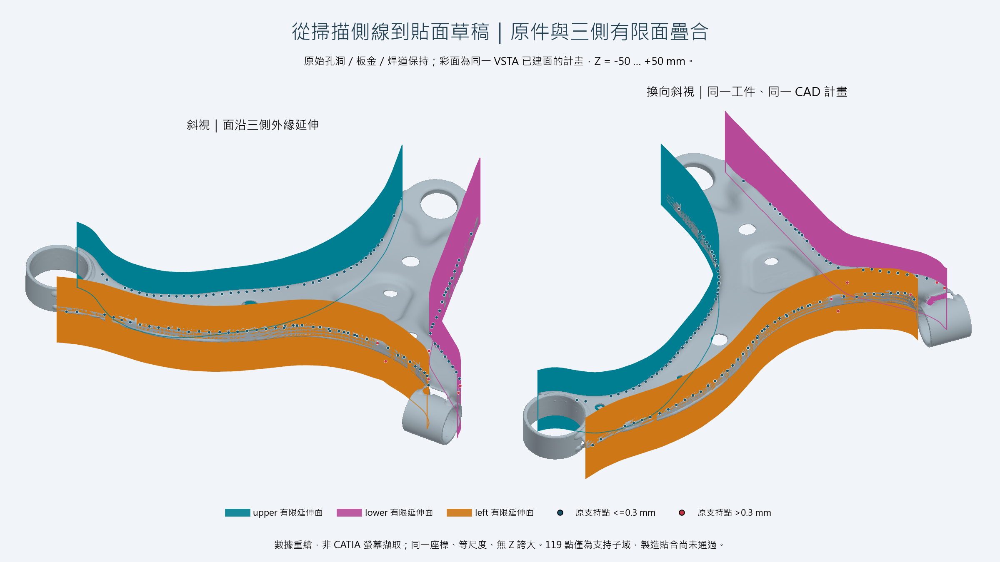

| 幾何／宿主工作 | 可讀程式與證據 |
| --- | --- |
| 原面剖切、支持身分、工程側線 | [Scan.cs](../src/Core/Scan.cs)、[SourceEvidence.cs](../src/Core/SourceEvidence.cs)、[EngineeringDraft.cs](../src/Core/EngineeringDraft.cs) |
| 有限 G1 線弧、精簡與尺寸重建 | [GeneralFitting.cs](../src/Core/GeneralFitting.cs)、[MultiBendFitting.cs](../src/Core/MultiBendFitting.cs) |
| 草圖、約束、讀回與有限延伸 | [MacroWorkflow.cs](../macro/MacroWorkflow.cs) 中的 `BuildSketch`、`ReadBack`、`CreateSurfaces`；[VSTA 操作](macro.md) |
| 有限面距離與局部剖面 | [SourceVerification.cs](../src/Core/SourceVerification.cs)、[解析垂足程式](../tools/contact_geometry.py)；[完整貼面案例](surface-contact.md) |

每條線弧 `c(t)` 延伸成 `S(t,z)=(cx(t),cy(t),z)`，`t` 受有限線段／有號弧掃掠限制。公開 Case A 使用 `z∈[-50,50] mm`；這是該計畫的高度，不是所有工件都適用的常數。Macro 透過 `AddNewExtrude` 建面，再讀回方向、兩側 offset 及更新狀態。三側合計 **165 元件、405 有效約束、3 草圖／3 延伸特徵**；這些數字只屬於[對應的原生計畫收據](evidence/case-a-vsta.json)，不套用到前面的局部平面圖集。

## 怎麼判斷這些面有工程價值

先問是否減少手動定面、描線與建面的工作，能否保留主要輪廓、肩部及需要的範圍，再看工程師還要改哪些地方。焊道簡化要核對被略過的是難加工細節，而不是必要的板金形狀。精度資訊用來定位問題；不因追逐較小數字而失去可編輯性或產生更多細碎面。

正視／側視、點群與原掃描同場，都能幫助判讀，但不單獨證明全區接觸。圖中金灰交錯可能包含遮蔽、相交及近共面顯示，**不是經量測的接觸區域**；多片矩形相互覆蓋也不代表已縫成連續曲面。實際省時幅度與全區焊道效果仍待量測／工程確認。[現行工程判準](engineering-acceptance.md)

## 圖的來源與可重現範圍

歷史 59 張圖取自使用者提供的圖集，以通用組號與原順序發布，沒有裁切、變形或補畫原生結果。已逐張視讀，無公司／產品名稱、帳號、檔案路徑或原生模型編號；原 Word、原始掃描及公司原程式留本機。[圖片對照與 SHA](evidence/historical-surfaces.json)

本頁兩張 SVG 是通用原理示意，不使用實件座標；三側彩色疊合是數據重繪。2026-11-08 已另補[現行三側計畫重新 F5 及原生同場兩視角](surface-contact.md#本次-catia-原生同場展示)，與歷史局部平面圖集分版。保存重開、距離／焊道工程接受仍未因圖片而通過。局部平面求解器的公開可執行重現與逐檔來源對應仍待補，本輪沒有新增平面擬合演算法。

[完整圖集](surface-gallery.md) · [側邊貼面與距離](surface-contact.md) · [技術對照](technical-map.md) · [歷史與貢獻](project-history.md)
