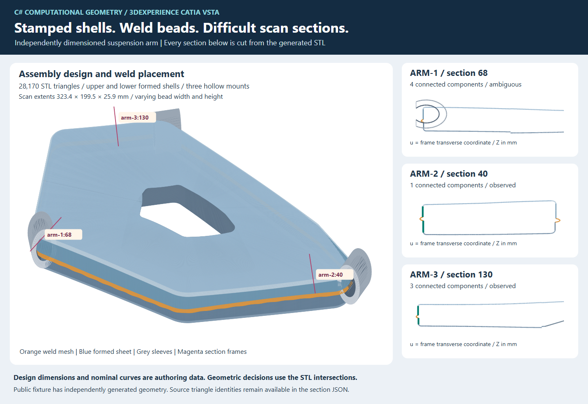
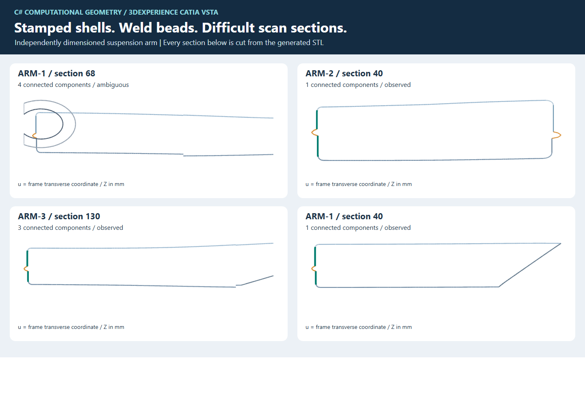
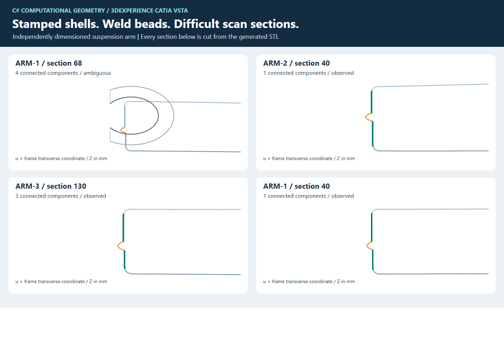
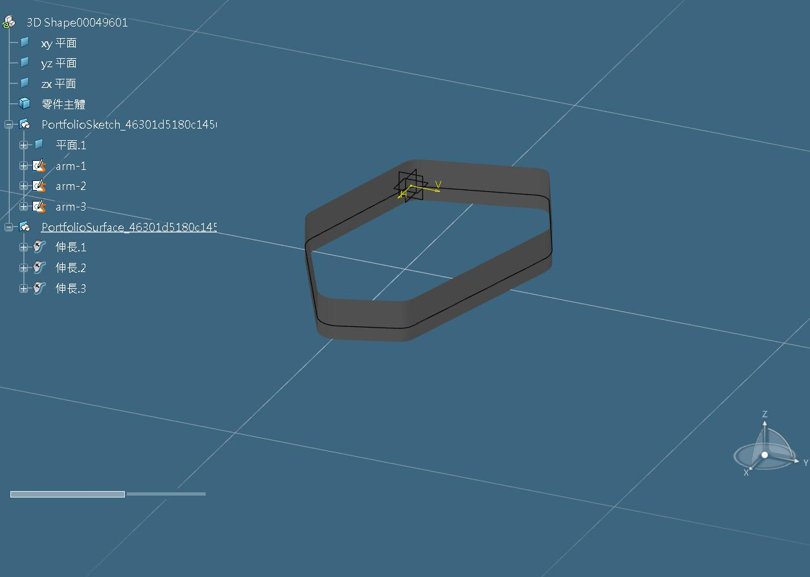

# 懸吊臂｜焊道、困難剖框與可編輯 CAD

這件懸吊臂由上下成形鈑金殼、中央開口、沿外緣起伏的焊道及三個中空套筒構成。第二件調整分支角度、輪廓、轉角半徑與安裝位置，兩件由同一組生成、判讀、擬合和 Macro 入口處理。尺寸與網格獨立設計，公開程式用來重現產學專案的工程決策。 [設計原始碼](../src/Core/SuspensionArmFixture.cs) · [歷史角色與貢獻](project-history.md)



## 設計與資料分界

主件有 28,170 個三角面與 714 個導引站，第二件有 27,182 面與 688 站。上、下殼的內孔邊界不同，蓋寬沿路變化。表面高度也隨站距起伏。焊道以寬度和外凸高度沿接縫變化的網格描述。套筒包含外壁、內孔和端面，會與同框的鈑金交線競爭。

`scan.stl`、`guide.asc` 和 `job.json` 是求解輸入。`design.json` 包含繪圖用的面角色與後驗名義輪廓。回歸先刪除這個檔案，再從 STL 求交、推導蓋標籤並輸出 CAD，最後由測試程式用先前讀取的名義幾何核對位置。`Guide.cover` 在此類案例填 `auto`。 [回歸入口](../tests/arm_acceptance.py)

ASC 是預先提供的參考輪廓。本合成件的導引與名義外壁相隔 0.2 mm，用於定義剖框方向及工程推估的參考位置。原始支持仍須由 STL 取得；推估品質則依賴這條參考輪廓及兩端觀測。讀者可以修改導引後重新量測這項依賴。

導引區間代表工程處理範圍。三個套筒仍保留在掃描中，剖框會顯示它們對板金側線判讀的影響。歷史原案的套筒交界範圍由工程人員確認，再輸入處理流程。 [原案的範圍與交付時間線](project-history.md)

## 焊道與困難剖框





圖中的每條線段都由 STL 三角面與指定剖面相交取得，JSON 保存 XYZ 端點及來源三角面索引。面角色只用於圖面著色。實際判讀沿共端點連通關係處理，保留多個連通分量。相鄰 STL 面可能回報相同幾何交線，走訪時會核對端點合併這種重複，原來源列表仍可查看。

| 剖框 | 實際困難與處理 |
| --- | --- |
| `arm-1:68` | 四個連通分量，套筒的圓形剖線與上下殼交線重疊。原始狀態為 `ambiguous`。工程草稿另記推估及原未定原因。 |
| `arm-2:40` | 同一分量包含上下蓋、轉角、兩段壁和外凸焊道。程式列出兩個蓋候選及各自寬度，沿蓋外端經過圓角追到近直壁支持。 |
| `arm-3:130` | 同框存在三個分量，近側蓋壁仍有可追溯的支持，其餘交線保留。 |
| `arm-1:40` | 上下殼的剖切跨度不同，內孔附近的交線也不同。自由方向的「看起來直」需要再核對幾何角色。 |

對主件焊道網格頂點量到 CAD 輪廓的最大 XY 距離為 2.132804 mm。處理後工程側線的取整最大 XY 為 0.009637 mm。兩個數字分別描述焊道頂點和工程側線，完整數據保存在摘要中。 [離線數據](evidence/arm-offline.json)

## 蓋壁判讀與工程推估

程式在每個完整剖框找連通的近水平蓋支持，量其局部橫向跨度，從靠近導引線的端點沿原交線走過轉角，再確認近直壁支持。兩個蓋的跨度以嚴格大小比較。角色 `upper`、`lower` 由該框候選高度關係產生；反轉導引仍可處理。 [判讀程式](../src/Core/ShellSections.cs)

| 公開工程參數 | 值與用途 |
| --- | --- |
| 剖框橫向半寬 | 110 mm，保留本合成件的上下殼及套筒上下文 |
| 蓋支持最小跨度 | 8 mm |
| 導引至蓋外端的範圍 | 4 mm |
| 蓋與壁方向比 | 0.2，分別限制高度變化／橫向變化，以及橫向漂移／高度跨度 |
| 壁支持最小高度跨度 | 2 mm |
| 來源共端點核對 | 1e-7 mm |

原始剖框判斷保持 `observed`、`gap` 或 `ambiguous`。當處理範圍內有相同蓋角色的兩端觀測時，工程草稿內插「支持點相對導引的橫向偏移」，並保留原始的 `sourceState`。推估點的三角面清單為空。欠缺兩端觀測或同蓋條件時維持未定。驗證器再從兩端觀測、導引與偏移公式重算。這是供工程師微調的衍生草稿。 [來源與推估核對](../src/Core/Verification.cs)

主件得到 705 個原始支持與 9 個推估點。第二件得到 683 個原始支持與 5 個推估點。原始支持逐點核對剖面及來源三角面。兩件的支持與推估位置均由獨立的名義有限曲線距離檢查落在 0.1 mm 內。這項 0.1 mm 檢查只適用於這兩件合成件。

## 多轉折擬合與尺寸取整

每側包含兩個轉折。程式從有序支持點找中間直線支持，以這段支持拆成局部相切擬合，再把共線接點合併。基準由兩組實際局部擬合的 6 個元件構成，合併後是 3 線 2 弧。全部原始點與弧長等分點都以有限線段及有限圓弧重驗。 [多轉折程式](../src/Core/MultiBendFitting.cs) · [有限曲線距離](../src/Core/Geometry.cs)

直線支持辨識使用五點窗，垂距上限 0.003 mm，連續支持窗至少六個。這個窗只用於側線擬合分段。剖框的蓋壁判讀另以來源和幾何角色處理。

取整時，固定各直線長度與弧半徑至 0.01 mm，依次嘗試調整一個弧的掃掠，建立閉合根的變號區間，再用二分法求解。整鏈旋轉至原首尾弦方向，所有接點共用同一個累積位置和切向。最後選取整位移界最小且通過 0.05 mm 的解。缺少閉合根或超差時保存失敗。

| 合成件 | 最大取整後 XY | 最大取整位移界 | 每側元件 |
| --- | ---: | ---: | --- |
| A | 0.009637 mm | 0.008188 mm | 6 → 5 |
| B | 0.009479 mm | 0.009059 mm | 6 → 5 |

兩件均通過原始及等分點 XY ≤ 0.3 mm、取整位移界 ≤ 0.05 mm、首尾／接點殘差 ≤ 1e-7 mm，以及 G1 切向差 ≤ 1e-7。單／雙／三弧的歷史搜尋、候選排序漏選與剪枝另有可跑反例。 [歷史方法索引](engineering-decisions.md)

## VSTA 原生實跑

在 CATIA R2022x 的 Visual Studio 2017／VSTA 編輯器，載入本次公開 Macro 和兩件懸吊臂各自的 CAD 計畫。儲存來源、建置專案，將專用測試庫設為啟始專案，再執行編輯器開始偵錯命令（F5／`Debug.Start`）。宿主 `DSYVstaDebugHost` 呼叫 `CATMain`，使用新示範 Part 建圖、讀回並建面。

| 幾何版本 | 草圖／有限元件／有效約束／延伸面 | 最大原生殘差 |
| --- | --- | ---: |
| A | 3／15／30／3 | 6.355287432313019e-14 mm |
| B | 3／15／30／3 | 4.322062729257126e-14 mm |

原生殘差門檻為 1e-7 mm。兩份收據的輸入雜湊均與各自公開計畫相同，並綁定本版 Macro 的正規化來源雜湊。草圖包含端點接合、相切與半徑驅動約束，有限面沿 Z 延伸至 −12～24 mm。 [A 收據](evidence/arm-vsta-a.json) · [A 計畫](evidence/arm-plan-a.json) · [B 收據](evidence/arm-vsta-b.json) · [B 計畫](evidence/arm-plan-b.json)



初次啟動發現方案沿用其他啟始專案，改以專用測試庫啟動。正確庫的第一次前置檢查又拒絕新側別名稱，原因是舊公開 Macro 限制 `side-1` 等名稱。改成具長度及字元檢查的通用名稱後重新編輯、建置和執行，取得上述成功收據。 [Macro 契約](../macro/MacroWorkflow.cs) · [宿主操作手冊](macro.md)

## 重跑與反例

先依 [首頁](../README.md#快速開始) 完成 `arm`。其餘案例以相同 `generate`、`run`、`verify` 命令換案例名稱及新目錄。

| 案例 | 預期可核對的結果 |
| --- | --- |
| `arm` | 三側通過，套筒處的原始未定與工程推估各自保留 |
| `arm-b` | 另一種外形，同程式完成三側，獨立 VSTA 收據 |
| `arm-gap` | 第二側上壁加入漏掃，原始缺口增加，衍生推估保持來源區分 |
| `arm-reversed` | 導引反序，三側仍通過，CAD 圓弧使用負掃掠 |
| `arm-switch` | 只改上殼內緣的局部寬度，實際選寬角色沿第二側切換，兩側擬合被扣留 |
| `arm-height` | 同一 STL、ASC 及 XY 線弧，只抬高有限面下界，三維接觸樣點超過 0.3 mm |

`arm-switch` 保留了「逐框寬度數值成立，跨框工程側線仍可能失敗」的反例。它與歷史混蓋的重複支持身分問題各有來源與適用範圍。 [歷史混蓋](history/mixed-cover.md) · [逐框選寬](history/wide-cover.md)

```shell
dotnet src/Cli/bin/Release/net10.0/Cli.dll section artifacts/arm-input arm-2 40
python tests/arm_acceptance.py
```

測試含兩件不同外形、原始支持高度被竄改的拒絕、刪除名義設計後重跑、負掃掠、多段取整和高度對照。WinForms 另實際繪圖。離線距離以原始支持及工程草稿樣點為範圍，原生讀回以本次合成草圖與有限面為範圍。 [驗收報告](verification.md) · [實作紀錄](arm-development.md)

## 重畫設計圖與剖框

把 `section` 輸出存為 JSON 後，執行 SVG 產生器。Python 3.10 以上即可從相同 STL 重畫。

```shell
dotnet src/Cli/bin/Release/net10.0/Cli.dll section artifacts/arm-input arm-1 68 > artifacts/a68.json
dotnet src/Cli/bin/Release/net10.0/Cli.dll section artifacts/arm-input arm-2 40 > artifacts/b40.json
dotnet src/Cli/bin/Release/net10.0/Cli.dll section artifacts/arm-input arm-3 130 > artifacts/c130.json
python tools/render_arm.py artifacts/arm-input artifacts/arm-design.svg artifacts/a68.json artifacts/b40.json artifacts/c130.json
python tools/render_arm.py artifacts/arm-input artifacts/arm-welds.svg artifacts/a68.json artifacts/b40.json artifacts/c130.json --sections-only --weld-zoom
```

Windows PowerShell 5.1 的 JSON 輸出請用 `Out-File -Encoding utf8`。產生器接受 UTF-8 BOM，並提供焊道局部放大。 [繪圖程式](../tools/render_arm.py)
