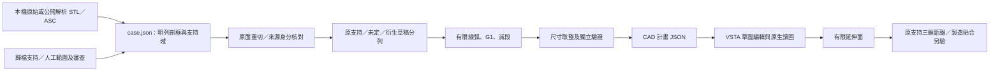

# 系統、執行與輸出

目前主要入口是 `source generate/run/verify`，包含顯式審查支持域、原面重切及一般多彎擬合。原件私有輸入、解析 fixture 與各輸出欄位見[Case A 重跑](original-case.md#重跑與本機私有資料)。下方 `generate/run/verify` 是保留的早期解析路徑，不是原件的自動物理分類器。

`run.json` 的 `fit`／最差點屬取整前。Viewer 現在直接標示 `max pre-round fit XY`、`display: rounded` 及紅圈階段；舊 SVG 的 `max fit XY` 仍是取整前，不能當最終 CAD 誤差。取整後驗收是 `source verify → sides[].cadXYMaximum`；主要[原件 PNG 疊圖](../assets/case-a-fitting.png)標示取整後數值與最差原草稿點。

## 資料流

CLI 與 WinForms 共享純 C# 幾何核心。Macro 經 JSON 邊界接收毫米幾何，編譯目標跟隨宿主。整段離線流程可跨平台重播。原專案歷史使用 VS2017、C# 7、.NET Framework 與 WinForms。

## 輸出與來源

| 現行 `source` 路徑 | 用途 |
| --- | --- |
| `case.json`、本機 STL／三側參考 ASC | 顯式支持域、範圍及指紋。私有原件不公開。 |
| `source-run.json` | `source` 原支持／全框狀態、`draft` 衍生點、`fitting` 嘗試及拒絕、`cadScope`。 |
| `run.json`、`overlay.svg` | 交給 Viewer 的側別與來源、2D 預覽；fit 標籤與紅圈為取整前。 |
| `cad-plan.json` | 原生 Macro 接收的有限毫米線弧、工作平面及高度。 |
| `source verify` 標準輸出／`source public-report` 指定檔案 | 完整重播後的驗收彙總；後者輸出固定公開欄位。此路徑不自動產生舊版 `verification.json`。 |

下表是保留的**早期解析 `generate/run/verify` 路徑**，欄位不可與上表混用。

| 檔案 | 用途 |
| --- | --- |
| `job.json` / `guide.asc` / `scan.stl` | 合成工作設定、順序導引點列、ASCII 或 binary STL 三角面。 |
| `run.json` | 每站狀態、來源三角面編號、蓋面標籤、基準與精簡線弧、取整結果、拒絕原因。 |
| `overlay.svg` | 藍色原始支持、橘色推估、紅圈最大 XY 誤差點。青綠是線、紫色是弧。 |
| `verification.json` | 原始與等分點最大 XY 偏差、取整位移上界、端點／接點／G1 殘差、取樣三維距離。 |
| `cad-plan.json` | 版本、毫米單位、來源指紋、草圖平面、有限 Z 範圍及通過的曲線。曲線由首尾、可空圓心及帶符號掃掠角表示。 |

`arm` 與 `arm-b` 是兩種早期解析懸吊臂外形。`arm-gap` 加入漏掃，`arm-switch` 改變局部蓋寬，`arm-reversed` 反轉導引，`arm-height` 只改有限面高度。設定的 `profile=formed-shell` 啟用來源蓋壁判讀，支持點另有 `height`，工程推估另有 `sourceState`。`section` 重切指定剖框並列出候選蓋與壁的原交線。[歷史解析案例](suspension-arm.md)

STL 讀取採逐行 ASCII 解析或依精確長度識別 binary；格式、單位約定與拒絕控制見 [STL 讀取與格式檢查](stl-input.md)。讀檔與幾何支持驗收分開判定。

`normal`、`reversed`、`gap`、`height`、`competing` 是小型基準。`workpiece` 與 `workpiece-height` 保留早期整件開口板金示範。各案例用相同 `generate`、`run`、`verify` 入口，並選新目錄。 [早期案例](workpiece-case.md)

工作指紋以設定、ASC、STL 的 SHA-256 串接。驗證器從掃描重播每個站位的狀態與來源三角面清單，再以三角面重心座標、剖面位置及有限曲線點距分別複核。即使 `run.json`、`cad-plan.json` 與 `verification.json` 互相一致，仍須符合原始輸入。`overlay.svg` 也會重製後核對內容。 [接手檢查與故障定位](handoff.md)

## 建置與除錯

- Windows 或 Linux 以 `dotnet build src/Cli -c Release` 建置。獨立回歸工具需要 Python 3.10 以上，Windows 可用 `py tests/acceptance.py`，Linux 可用 `python3 tests/acceptance.py`。
- WinForms 用 `dotnet build src/Viewer -c Release`。開啟 `run.json` 後用選單切側。找不到輸出時，先看 CLI 的結束碼與錯誤訊息。已存在的非空輸入／輸出目錄會被拒絕，以保留前一次結果。
- Macro 的參考組件、宿主編輯與故障排查見 [VSTA 指南](macro.md)。
