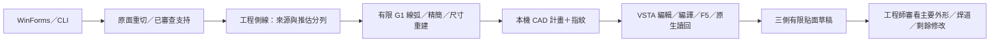

# 技術、程式與工程判斷對照

主案例是含孔洞、肩部、短肢、套筒和焊道起伏的原始 Case A。目標為可編輯貼面草稿，讓工程師集中處理局部修改。C# 幾何負責把資料變成可追溯的有序有限幾何；3DEXPERIENCE CATIA C#／VSTA 負責宿主編輯、約束求解、讀回與建面。

貼面範圍還包含歷史的**選取點群自動平面擬合**；[方法與圖解](surface-methods.md)以中央凸台、長肢、孔座及短肢肩部說明方向、位置、有限範圍與正側視。這條歷史求解器尚未逐檔對應為公開可跑程式，不能把下表的側線／線弧程式當成該平面求解器。[59 張歷史圖](surface-gallery.md)與目前原生計畫分版記錄。

## 幾何能力如何核對

| 技術與入口 | 演算／判斷 | 解決的工程問題與限制 |
| --- | --- | --- |
| [STL／平面求交與組串](../src/Core/Scan.cs) | 有號距離求三角形交線，共端點組串，保留原面 ID | 不用極角排序製造跨缺口長弦；連通不代表選對主壁。 |
| [精確支持幾何](../src/Core/SupportGeometry.cs) | 凸包最窄帶、BigInteger 二進位有理數交點／順序比較 | 小差值不被任意 epsilon 改成平手；數學順序不是物理身份證明。 |
| [來源與支持身份](../src/Core/SourceEvidence.cs) | 原面、有限邊、蓋壁支持、重用矛盾與人工排除核對 | 防止來源選錯後，擬合再精確也保留凹折。 |
| [參考站距與樣條](../src/Core/ReferenceGeometry.cs)、[工程草稿](../src/Core/EngineeringDraft.cs) | 有限投影、弧長、偏移插值、自然三次樣條與三維等分 | 將近似支持轉為有序草稿，缺點可明示推估；原始缺口與衍生點分開。 |
| [一般 G1 線弧](../src/Core/GeneralFitting.cs) | 有限弦支撐、帶符號轉角、相切退距／圓心、逐支持移除 | 用可編輯元件表達多彎輪廓；每個候選重驗距離及連接，未證全域最少。 |
| [尺寸重建](../src/Core/MultiBendFitting.cs) | 線長／半徑 0.01 mm、方向與閉合重建、參數位移界 | CAD 尺寸不是只改顯示文字；取整失敗保留明確階段。 |
| [獨立核對](../src/Core/SourceVerification.cs)、[面垂足](../tools/contact_geometry.py) | 有號有限弧、線端夾取、解析切向、有限 Z 距離 | 區分擬合、轉接、形狀可用及製造接觸；0.3 mm 是診斷參考。 |

[公式與假設](source-geometry.md) · [原件剖框／實測](original-case.md) · [25 個歷史反例](engineering-decisions.md)

## C#／VSTA 與操作工程

| 技術與入口 | 可核對內容 |
| --- | --- |
| [桌面流程](../src/Viewer/DraftWorkflow.cs)／[WinForms](../src/Viewer/Program.cs) | 背景計算、進度、來源保護、新輸出、GUI／CLI 同幾何結果、可審看未取整狀態。 |
| [宿主來源生成](../macro/prepare_vsta_sample.py) | 保留新 VSTA 庫 namespace／ThisApplication 介面，把同一份計畫與 C#5 相容工作流程編入來源。 |
| [Sketcher／Macro](../macro/MacroWorkflow.cs) | OpenEdition、正負有號弧首尾映射、端點／相切／半徑驅動約束、CloseEdition、Update、原生幾何與約束狀態。 |
| [外部 STA 診斷](../macro/StaRunner.cs) | COM 參考 Part、同計畫重播、錯誤來源隔離；與編輯器 MTA 實測入口分開。 |
| 指紋／Part 與草圖身份 | 避免第二支用錯模型、舊計畫或舊成功收據。手調後不可把舊讀回結果移用。 |
| [跨平台與回歸](../tools/verify.py) | Windows／Linux 純數值流程、Windows 實際開檔／繪圖／生成，以及壞來源／壞輸出拒絕；授權 VSTA 另驗。 |

目前原件 VSTA 實跑為 165 元件、405 有效約束、三草圖／三面；幾何讀回最大 8.95e-13 mm 是轉接一致性。它不等於省時幅度、全部自由度鎖定或全區焊道已辨識。[宿主實際除錯](macro.md)

## 面試可以沿三個問題說明思路

1. **為什麼漂亮曲線仍可能錯？** 用混蓋／支持重用說明：先找錯誤進入哪層，再用同版單錨點對照定位；不靠平滑掩蓋來源。
2. **為什麼保留被取代的方法？** 單／雙／三弧的受控可行解證明模型存在；候選排序漏選說明搜尋覆蓋仍不同。保留可重跑反例，才說得清楚改決策的理由。
3. **為什麼不只追更小誤差？** 比較 129／165 元件的工程取捨，說明主要輪廓、焊道細節與剩餘手調。自動建立元件是已量事實，工時百分比另需對照。

履歷寫可追溯的開發與實跑，不以公開重寫的檔案數替代歷史作者證據。[角色分界](project-history.md) · [完整驗收](verification.md) · [後期歷史取整紀錄](historical-rounding.md)
