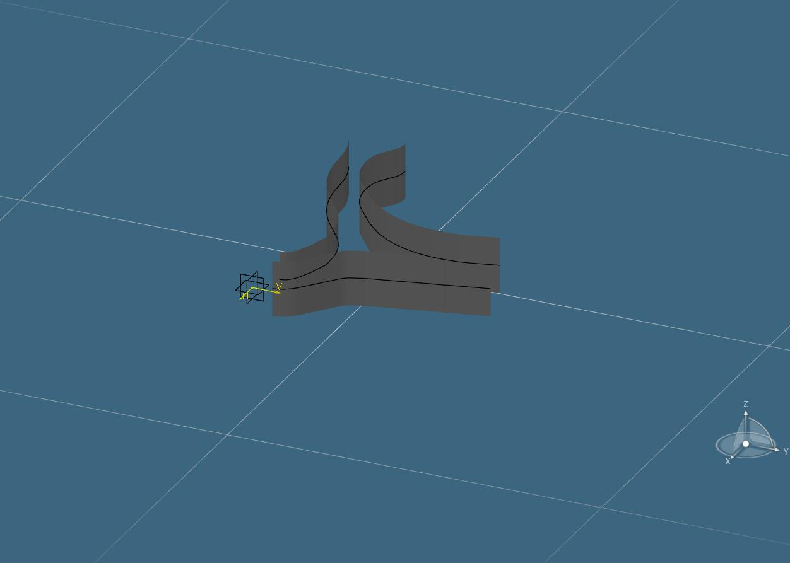

# 驗收與證據

首頁主案例已改為未修改的原始 **Case A**。原始檔留本機，公開彙總見 [case-a-geometry.json](evidence/case-a-geometry.json)，完整判準與取樣域見[原件報告](original-case.md)。

## 原始 Case A 本次驗收

| 層次 | 判準 → 實測 → 適用範圍 |
| --- | --- |
| 原來源身分 | ≤1e-7 mm → 最大5.684e-14。重切342,369原面、83框及全部供應支持；沒有修改原STL。 |
| 草稿語義 | 與凍結歷史草稿座標差≤1e-7 → 最大1.214e-13 mm。三側點數1,038／779／1,013一致，oracle不作程式輸入。 |
| 有限線弧 | 全部原草稿點與0.5mm等分點各≤0.3 → 取整後0.297692／0.294194／0.262203 mm。獨立有限距離重算。 |
| 實際尺寸取整 | 線長／半徑0.01mm，位移界≤0.05 → 0.008787／0.004678／0.022314 mm；解析曲線位移上界。 |
| 端點與G1 | 首尾／接點≤1e-7mm、單位切向差≤1e-7 → 最大首尾1.35e-13mm、接點0、切向6.84e-14。 |
| 原始支持錨點子域接觸 | ≤0.3mm → 0.279204／0.698534／1.799857mm，**後兩側未過**。不是完整STL或已確認接觸帶。 |
| 新版原件 VSTA | 新獨立庫在編輯器建置／F5實跑；同一計畫SHA，3草圖、165有限元件、405有效約束、3個Z±50mm有限面。最大原生殘差8.952838470577262e-13mm≤1e-7。見[當次收據](evidence/case-a-vsta.json)。 |
| Windows | CLI／Viewer零警告建置；新來源與數學控制、既有7案、6個懸吊臂回歸、STL解析與25反例通過。原件三側Viewer實際開檔／繪圖。 |
| Linux | Debian12／Linux6.1／.NET10.0.403的QEMU客體完成本機原件建置、三側線弧及獨立重播驗證，exit0。數值核心來源指紋與Windows相同，已比較指標最大差4.72e-14mm。另完成數學／來源／STL／7案及25反例。[Linux收據](evidence/case-a-linux.json) |
| 製造貼合 | **未通過／接觸帶未物理固定**。CAD建面與數值草稿成功不改變此狀態。 |

本次公開解析 fixture 與原件不同，兩者使用同一新程式。fixture有66框／3審查排除／126支持端點，每側13→11段，取整XY最大0.137150mm；它刻意保留不合格的原支持接觸，避免把測試件當實物驗收。

Windows完整11步驟見[實測摘要](evidence/case-a-windows.json)。Debian跑的是實際Linux程式，不是Windows交叉發佈；它仍是QEMU虛擬機，未宣稱裸機測試。Windows與Linux的CAD計畫原始bytes／SHA不同，收據分別保留，不把Windows VSTA成功套到另一個SHA。兩側草稿點距、取整界及接觸樣點指標各自在原平台重算並通過對應判準。Debian額外的舊六懸吊臂回歸為釋放TCG資源而停止，未列為Debian成功；這六案已在Windows通過，並保留於Windows／Ubuntu CI。

原生圖是 `Viewer.CaptureToFile` 直接匯出；在 CATIA 隱藏樹狀身分後擷取，未編修像素。只顯示新建的三個草稿延伸面，未匯入原掃描或冒充完整板金重建。新 Part 目前留本機，PLM保存未確認。收據的有效約束不代表所有草圖自由度均鎖定。

舊懸吊臂解析案例仍保留：兩件各3草圖、15有限元件、30有效約束、3延伸面，最大取整XY為0.009637／0.009479mm，原生殘差6.3553e-14／4.3221e-14mm。這些是舊外形與舊Macro SHA的證據。[歷史解析案例](suspension-arm.md)

下方保留早期 `normal` 基準及歷史結果，各自對應原有測試範圍。

## 公開合成案例

在 Windows 以 .NET 10 建置，從新目錄重跑正常、反向導引、缺口、競爭支持與延伸高度五個案例。每案各跑兩次，四個輸出逐位元核對。25 個歷史程式各自執行並與批次輸出核對。十個負控制均被拒絕，涵蓋修改剖切點、反轉 CAD 弧、覆寫舊目錄、重複來源三角面、偽造缺口、扣留本可通過的側線、兩種空白導引設定，以及替換與移除預覽圖。驗證器會從原始掃描重播站位及來源清單，即使多份輸出一起被改動也能發現不符。 [回歸入口](../tests/acceptance.py)

| 判準 | 正常合成件實測 | 核對方式 |
| --- | ---: | --- |
| 減段後，原始與等分點 XY 偏差各 ≤ 0.3 mm | 原始點最大 0.000001202 mm，等分點最大 0.005370 mm | 對減段後的有限線段及圓弧重算兩組點距。 |
| 取整後，原始與等分點 XY 偏差各 ≤ 0.3 mm | 兩組合計最大 0.051162 mm | 對線長、半徑取整並重建後的有限曲線重算點距。 |
| 線長、半徑取至 0.01 mm，取整位移上界 ≤ 0.05 mm | 上界最大 0.047324 mm | 核對實際尺寸及線弧參數位移界。 |
| 首尾、接點殘差各 ≤ 1e-7 mm | 3.98e-15、3.56e-15 mm | 對原始支撐、基準、減段和取整鏈重算。 |
| G1 切向單位向量差 ≤ 1e-7 | 2.76e-15 | 以有向弧切向量和線方向重算。 |
| 每側可編輯元件減少且通過同一判準 | 三側均由 6 段合併為 3 段 | 每次接受前重驗原始點及等分點。 |
| 有限延伸面的三維取樣距離 ≤ 0.3 mm | 正常件最大 0.046960 mm | 以探測點至有限延伸面重算，包含 XY 與超出高度的距離。 |

缺口案例第二側有 4 站未定，其他兩側可輸出 CAD 草圖計畫。競爭支持案例保留 `ambiguous` 站。高度案例的取整後原始與等分點的最大 XY 偏差為 0.051162 mm，三維取樣距離至少 0.700 mm，超過 0.3 mm 的取樣判準。量測範圍限合成探測樣點。 [缺口預覽](../assets/gap.svg) · [距離推導](geometry.md#實際尺寸取整)

## 原生 CAD 與製造驗收分開看

| 驗證層 | 本次結果與適用範圍 |
| --- | --- |
| 公開範例編譯與外部 STA 原生執行 | 外部 .NET Framework 範例以本機 CATIA Interop 編譯。將正常合成計畫送入 CATIA 原生 API，在新示範 Part 建立 3 個草圖、9 個有限元件、15 個有效約束、3 個有限延伸面。草圖最大殘差 1.465e-14 mm，原生偏移讀回為正 3 mm、負 2 mm。 |
| 公開範例原生負控制 | 反轉有號圓弧、使用不同草圖標記、改變計畫指紋及重複建面均被拒絕。追加原生實測中，計畫外實線與改成施工線的必要曲線也各自在建面前被拒絕，且沒有成功收據。 |
| 公開範例施工輔助線 | 用同一份合成計畫，在另一個新示範 Part 加入同形狀的施工輔助線，仍建出 3 個有限延伸面。 |
| VSTA 編輯器內執行 | 在 CATIA R2022x 的 Visual Studio 2017／VSTA 專案加入公開 Macro 原始碼和同一份正常合成計畫。IDE 建置通過，F5 進入 `DSYVstaDebugHost` 的 `CATMain`，使用宿主的 CATIA 應用物件。讀回 3 個草圖、9 個有限元件、15 個有效約束，最大殘差 `1.465e-14 mm`，並建立 3 個有限延伸面。兩份收據的計畫雜湊均與合成輸入相同。 |
| 歷史產學版本 | 先前版本曾完成原生草圖讀回及延伸面。歷史最新取整版的原生試跑停在參考 Part 前置檢查，各版本證據各自歸屬。 |
| 實際工件製造貼合 | 原專案仍待通過製造貼合驗收。合成樣點與原生讀回的量測範圍見前述判準。 |

## 核對 VSTA 驗收證據

[去識別收據](evidence/vsta-editor.json) 取自既有公開合成件的 VSTA 實跑。保留宿主入口、每個草圖的元件數、有效約束與最大殘差，以及有限延伸面的讀回數量和範圍。`planSha256` 與兩份原生收據及執行記錄一致。可下載[同一份合成 CAD 計畫](evidence/vsta-synthetic-plan.json)，用 Windows `Get-FileHash` 或 Linux `sha256sum` 核對原始位元組。`workflowSha256` 取自去除 BOM、統一為 LF 並去除尾端空白的 Macro 原始碼。

早期收據的 `workflowRevision` 指向當時的公開 Macro 版本。懸吊臂新增 [A 收據](evidence/arm-vsta-a.json)與 [B 收據](evidence/arm-vsta-b.json)，綁定目前 Macro 來源和各自的合成計畫。離線回歸核對計畫雜湊、曲線數、殘差與約束數；原生行為可循 VSTA 入口重跑。 [離線核對](../tests/acceptance.py) · [VSTA 手冊](macro.md#在-vsta-編輯器建置與執行)

## Debian Linux 執行

在本機 QEMU 虛擬機啟動 Debian GNU/Linux 12，核心為 `6.1.0-54-cloud-amd64`，使用 `.NET SDK 10.0.403` 與 Python `3.11.2`。從封裝的原始碼在客體內建置 CLI，得到 0 警告、0 錯誤。五個合成案例、五次逐位元重跑、十個負控制與二十五個歷史範例全部通過。另以正常件產生並驗證 3 側 CAD 計畫，整個腳本結束碼為 0。兩個平台各自驗證幾何判準及同環境重播。

Debian 實跑所用的 CLI、幾何核心及當時的離線回歸程式，與下列公開基準的檔案內容一致。本版另以 GitHub Actions 的 Ubuntu 與 Windows 重跑更新後的回歸。Windows 開檔測試包含遺失檔案、截斷 JSON、空側線紀錄，以及正常件和缺口件的實際繪圖。 [公開基準](https://github.com/YunXi503/cad-workpiece-automation/tree/233ab7a36eace2b6ab33187c348ea266e915335f) · [雙平台工作流程](../.github/workflows/verify.yml) · [WinForms 開檔測試](../tests/viewer_open.py)
