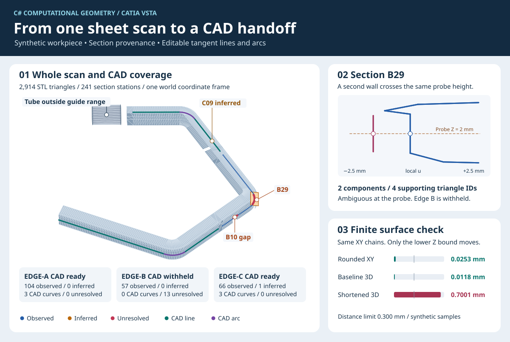

# 整件工程案例｜板金掃描、剖框追查與 CAD 交付

原專案的難點是先確認哪一段原始掃描真的支持工程側線。局部看起來平直、逐框選出的蓋最寬、或最後的線弧擬合誤差很小，仍可能沿著錯誤的壁。工程人員還需要圈定套筒、肩部與有效交付範圍。這裡用獨立尺寸建構一件開口板金，讓這些決策在同一座標系內逐步重跑。 [原專案時間線與角色](project-history.md)



## 輸入長什麼樣

ASCII STL 有 **2,914** 個三角面，包含三側相連的板金路徑、上下翻邊、上緣凸脊，以及在 C 側導引範圍外的套筒。ASC 有 **241** 個導引站，與側壁保有橫向偏移。`job.json` 將站位分成三個有序區間。這些範圍由合成件設計明示，對應到歷史專案中由工程人員確認板金肩部及套筒交界的工作。STL 保有套筒，程式只在導引範圍內採集剖框。 [合成件原始碼](../src/Core/WorkpieceFixture.cs)

| 合成條件 | 要回答的工程問題 |
| --- | --- |
| B 側部分壁面缺失，上緣蓋仍存在 | 剖到蓋或凸脊時，是否會誤認為仍有側壁？ |
| B 側另有一條外側近垂直片 | 同一探測高度有兩個不同位置時，候選是否維持未定？ |
| C 側只有一站缺少原支持 | 左右相鄰同蓋且均有觀測時，推估點能否與原始點分開保存？ |
| 套筒出現在掃描，但在末站之外 | 能否保留原網格，只在已指定的工程範圍交付側線？ |
| 同一 STL、ASC 和 XY 草圖，抬高延伸面的下界 | 平面公差通過時，有限面是否仍可能因高度失配而超差？ |

## 逐站追查

依 [首頁快速開始](../README.md#快速開始) 生成 `workpiece` 後，使用 `section` 直接從 STL 切指定剖框。命令使用從零開始的站位索引。`components` 存每條交線的兩個 XYZ 端點與 `triangle` 索引，`rawSupport` 存推估前的判斷。完整側線的結果在 `run.json` 的 `sides[].stations`。 [剖切、組串與站位程式](../src/Core/Scan.cs)

```shell
dotnet src/Cli/bin/Release/net10.0/Cli.dll section artifacts/workpiece-input edge-b 29
dotnet src/Cli/bin/Release/net10.0/Cli.dll section artifacts/workpiece-input edge-b 10
dotnet src/Cli/bin/Release/net10.0/Cli.dll section artifacts/workpiece-input edge-c 9
```

1. **B29 有兩個壁支持。** 以局部橫軸 `u` 表示交線。兩個共端點分量都跨過 `Z=2 mm` 的探測高度，來源三角面索引為 `1564`、`1572`、`1579`、`1587`，形成兩個不同的 XY 支持位置。該站存 `ambiguous` 與來源 ID，沒有錨點座標。
2. **B10 剖到蓋，側壁支持中斷。** 此站 `rawSupport.state` 是 `gap`。連續四個 `gap` 缺少單站內插所需的兩個相鄰觀測，B 側另有九個 `ambiguous`，因此整側扣留。
3. **C09 可推估。** 原始剖框仍是 `gap`。C08、C10 都有同一蓋標籤的實測壁支持，故完整側線以兩點的中點補一站，記為 `inferred`，來源三角面清單為空。合成蓋標籤由工作設定提供。

歷史混蓋凹折屬於另一種來源錯誤。兩個候選被標為不同蓋，卻共用一整組原始支持邊。異常先出現在工程錨點，後續線弧保留了凹折。當時以相同程式隔離單一錨點，才把問題定位到配對與來源身分。B29 則是兩個不同位置的競爭壁。這兩個案例一起說明為何要在擬合前區分候選身分與支持位置。 [歷史混蓋與獨立反例](history/mixed-cover.md) · [逐框最大寬度的限制](history/wide-cover.md)

## 線弧交付與可量測的邊界

| 側別 | 觀測／推估／未定 | 線弧結果 | 取整後最大 XY | 取整位移上界 |
| --- | --- | --- | ---: | ---: |
| A | 104／0／0 | 兩線一弧 | 0.021002 mm | 0.009520 mm |
| B | 57／0／13 | 扣留，保留原始剖框證據 | — | — |
| C | 66／1／0 | 兩線一弧 | 0.025340 mm | 0.013024 mm |

在 A、C 側，擬合先求兩端支持方向及相切圓弧，將原始點和弧長等分點到有限曲線的距離一起核對。公開示範把各段切半作為 6 段可編輯基準，再經同公差合併成 3 段。線長和半徑取至 `0.01 mm` 後重建，驗證門檻為最大 XY `≤ 0.3 mm`、位移上界 `≤ 0.05 mm`、首尾及接點殘差 `≤ 1e-7 mm`，G1 切向單位向量差 `≤ 1e-7`。本例一側使用一條線弧鏈，歷史方案另包含多弧搜尋與支持移除後重擬合。 [擬合與取整](../src/Core/Geometry.cs) · [獨立驗證器](../src/Core/Verification.cs) · [歷史多弧與減段](engineering-decisions.md)

## 高度單變數對照

```shell
dotnet src/Cli/bin/Release/net10.0/Cli.dll generate workpiece-height artifacts/workpiece-height-input
dotnet src/Cli/bin/Release/net10.0/Cli.dll run artifacts/workpiece-height-input artifacts/workpiece-height-output
dotnet src/Cli/bin/Release/net10.0/Cli.dll verify artifacts/workpiece-height-input artifacts/workpiece-height-output
```

兩案的 STL 與 ASC 逐位元相同，輸出的 XY 線弧也相同。將有限面的下界由 `0` 抬到 `2.7 mm` 後，探測高度 `Z=2 mm` 落在面外。兩側取整後最大 XY 保持 `0.025340 mm`，最大三維取樣距離由 `0.011783 mm` 增至 `0.700099 mm`，超過 `0.3 mm`。`verification.json` 同時保留 `status` 和 `contactState`，分別回答幾何草圖與有限面接觸。這項量測以合成探測點為範圍。 [三維距離推導](geometry.md#實際尺寸取整)

本頁的整件案例已完成離線 STL 至 `cad-plan.json`。VSTA 編輯器 F5、約束、原生讀回與建面的公開證據來自 `normal` 小型基準。實際工件的製造貼合另有獨立驗收狀態。 [VSTA 原生證據與適用範圍](verification.md#核對-vsta-驗收證據)

## 重畫首頁圖

先完成兩案的 `generate`、`run`、`verify`，再用下列命令匯出 B29 的剖框及 SVG。圖面使用三角網格、站位狀態、已通過的曲線與距離報告。Python 需要 3.10 以上。

```shell
dotnet src/Cli/bin/Release/net10.0/Cli.dll section artifacts/workpiece-input edge-b 29 > artifacts/b29.json
python tools/render_workpiece.py artifacts/workpiece-input artifacts/workpiece-output artifacts/workpiece-height-output artifacts/b29.json artifacts/workpiece.svg
```

使用 Windows PowerShell 5.1 時，將 `section` 的輸出以 `Out-File -Encoding utf8 artifacts/b29.json` 寫入。 [SVG 產生器](../tools/render_workpiece.py)
